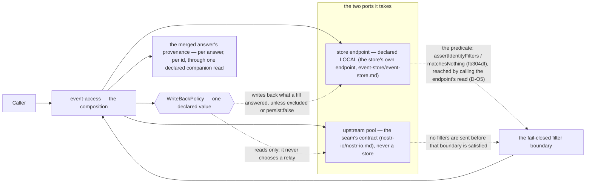

# event-access — one answer over the store and the relays, one write-back policy, one honest completeness fact

**The job, in one sentence** — answer a caller's event operations over **both tiers** — the store's local
endpoint and the injected upstream pool — merging them local-first with **one declared, inspectable write-back
policy** and reporting, honestly, whether the answer is complete.

This document is the **spec**. `ts/` holds the first implementation — TypeScript, over the vendor's three
write-back operators **read and not adopted**: `mapEventsToStore` and its alias `filterDuplicateEvents` are
`applesauce-core`'s, and `storeEvents` is the transport package's, while `applesauce-loaders` **6.2.0** —
installed inside `event-access/ts` by this increment, and exporting **none** of the three names — is what
settles the `UNVERIFIED` label this sentence carried. Both operators that exist take a **store object**, which
this module has none of and may not take, so the policy is implemented directly against the `StoreEndpoint`
port rather than by adopting them. `evidence/` holds the commands that regenerate what this document claims, and
both directories exist: the module is this run's **second increment**
(`runs/2026-09-29-reframing/order.md` §1), and the spec was written first.

**Amended 2026-09-30 — the preamble above, corrected in place, with its measurements and its sources.** The
correction sits here rather than beneath the paragraph because this region is editable prose: it carries no
identity token and is not a declaring line, so the "body beneath" rule that governs a frozen statement does not
attach to it. Four clauses changed, each measured on this increment's own install:

1. `over `applesauce-loaders` 6.2.0's write-back operators` → the vendor's three operators, **read and not
   adopted**. `mapEventsToStore` and its alias `filterDuplicateEvents` are `applesauce-core` 6.2.0's
   (`event-access/ts/node_modules/applesauce-core/dist/observable/map-events-to-store.d.ts:8,10`, `MEASURED`);
   `storeEvents` is `applesauce-relay` 6.2.1's, read from the sibling seam's own install
   (`nostr-io/ts/node_modules/applesauce-relay/dist/operators/store-events.d.ts`), because it is **not**
   installed inside this module — so **that one name stays `UNVERIFIED` in this module's install** while the
   other two are `MEASURED` there. `applesauce-loaders` 6.2.0, installed inside this directory
   (`find event-access/ts -maxdepth 4 -name applesauce-loaders -type d` →
   `event-access/ts/node_modules/applesauce-loaders`, MEASURED 2026-09-30), declares and exports **none** of the
   three: its own `operators/` subpath ships `complete-on-eose`, `distinct-relays`, `distinct-timeout` and
   `generator`, and its loaders **import** the two from `applesauce-core`. The operator **shapes** match
   `runs/2026-09-29-event-store/research/05-applesauce-precedent.md`'s record byte for byte, so what moved is
   the **attribution**, not the shape: order §5.2's stop condition does not fire and this is spec text.
2. `adopted as *implementations* of this policy` → **not adopted, and not adoptable here**: both existing
   operators take a store object (`IEventStoreActions` / `IEventStore`), and `applesauce-core` may not be a
   dependency of this module (order §2; `#0c7fe3`). `ts/policy.ts` implements the policy directly against the
   port, and its own header carries the measurement in full.
3. `the package is not installed in this assembly — measured … returns nothing` → **stale as of this
   increment**: it was true when written, and the install is what made it stale.
4. `Neither exists yet` → both exist, because this increment landed them. The front-matter
   `levels.implementation`/`levels.tests` readings of "none yet", and the target → increment map's "nothing:
   this document" for I2, hold **as of the spec's first writing only**; reconciling them is the orchestrator's.

**Reversal:** one word; this correction moves no declaration and adds no statement.

**Where it sits.** Above it, a caller; below it, two ports. It imports the store's endpoint contract and
`nostr-io`'s pool contract, and **it is the only module that knows both**: the store never learns about relays
and the seam never learns about a store. Nothing in this module opens a socket, and nothing in it names a head
rule or a filter predicate of its own.

## The statements

One statement per behaviour, each a line of its own with its content-hash identity assigned by
`python3 core/checks/check.py --root . --assign` — never typed.

- `#30c592` — `event-access` owns the caller-facing event operations — query, subscribe, publish, count, delete and the `{events, complete}` envelope `query` answers with — over the store's local endpoint and the injected upstream pool, and it is the only module that knows both tiers.
- `#b7446b` — It is the composition module `platform-core` adds on 2026-09-29 (`#120968`): the two modules it composes are unchanged by it, its ports are the store's endpoint contract and the seam's pool contract, and it holds no socket of its own.
- `#fadb8a` — This directory is a spec with many implementations (`#465561`): the TypeScript one in ts/ is the first, and a host on another stack realises the same contract by adapting the two ports without inheriting this implementation's idiom.
- `#66810d` — It is **new at its final state** rather than extracted: what it replaces is a decision nobody owned — the caller-side write-back an ecosystems' composition layer leaves to each call site, applied by 4 of 11 of its own loader modules (`runs/2026-09-29-event-store/research/05-applesauce-precedent.md` section 4, MEASURED there) — and the local-first sequence every market read site decides again for itself.
- `#af4552` — **The six operations are the five NIP-01 verbs and the envelope**: `query`, `subscribe`, `publish`, `count` and `delete`, each with its options, plus the `{events, complete}` envelope `query` resolves with — the sixth entry, which is why this module lists six and not five.
- `#8cd1d6` — The options that move with the operations are `localFirst` (default true), `deadlineMs` (default 8000), `persist` (default true) on a read, and `onlyNew`, `closeOnEose` and `signal` on a subscription, while the store endpoint keeps its own `keep*` read options beside them.
- `#dce3ab` — `query` returns `QueryResult {events, complete}` exactly as the re-cut carries it and never a bare array, because a bare array cannot carry "the deadline fired" and a caller renders a partial list as the whole answer.
- `#6de405` — **`count` never fetches** (M14): it counts through the store's endpoint, it reports `approximate: false` because the local index is exact, and it is the local one of the two counts — the wire's NIP-45 count is a different operation and belongs to `nostr-io`.
- `#2ffa85` — **`publish` writes locally before or independently of any relay attempt** (M14) and never depends on a relay accepting: `stored` is the local write's outcome, `accepted` and `refused` are the relays' own answers, and a publication no relay took is still a local write.
- `#239d01` — `subscribe` never publishes, its cancellation is idempotent, and **no subscription is ever silently dropped** (M13): a subscription that spans both tiers either lives or ends with a stated reason.
- `#4a3296` — **LF-1 · the local answer precedes any network participation**, asserted on the `query{localFirst:true}` path and, by call order on a recording pool, on the subscription's replay path.
- `#043f40` — **LF-2 · the fill's events are written back through the store endpoint**, asserted on the query fill path and on the subscription fill path, with the one exception the read itself declares through `persist:false`.

**Amended 2026-09-30 — the orchestrator's decision D-O17.** Read the LF-2 criterion with this amendment: it
carries an **expected write count** on the endpoint fake, which **records every write** (the count _and_ the
events written are asserted, so no criterion is satisfied by a fixture that recorded nothing); and the
`persist:false` criterion carries its **positive companion** — the same fake with `persist:true` **does** write
back, counted. Both halves are asserted, because "a later read does not see it" is satisfied by an
implementation that never writes anything at all, and that shape is not admissible.

- `#8cb8af` — **LF-3 · a later write reaches open subscriptions exactly once**, asserted on the subscription path, whether the write came from a publish, from another read's fill, from a deletion or from expiry.
- `#7678d2` — **LF-4 · on a cold cache "not local" is never "not there"**: the local answer is the empty set and `complete` is false, asserted on the `query{localFirst:true}` path against an empty store endpoint, and a genuinely absent set is a second read's answer rather than an option on the first.
- `#cf8c70` — **LF-5 · a deadline resolves with what arrived and says so**, asserted on the `query{localFirst:false}` path against a pool that never answers, because a local answer is never withheld by a slow relay (M8).
- `#d0ba44` — **LF-6 · a relay failure reduces completeness, never the answer**, asserted with a throwing pool on every read path, and the failure is a stated reason rather than an empty set.
- `#df42e2` — **LF-7 · one event is the same sequence with one element**, asserted on the pointer path by call order on the recording pool — local first, then relay hints, then extra relays — and this spec states that this is the path it covers, because the ecosystem's own timeline path is a concurrent merge and a capability on one path is never stated as supported for another.
- `#6c19d5` — **The ordering is normative per named path**: P1 `query{localFirst:true}`, P2 `query{localFirst:false}`, P3 `subscribe` and P5 the pointer read carry the sequence, while P4 `publish` and P6 `count` are not reads and carry no ordering claim at all.
- `#42626d` — **The merged answer's provenance is per answer and per event id** (M12): a declared companion read reports the tier that produced an id within an answer, and telling a locally answered event from a network-answered one never depends on a flag mutated on a shared event instance.
- `#5015f4` — The vendor's provenance is deliberately **not adopted**: its single bit marks the canonical stored instance "from cache" and a later network add does not clear it (`research/05-applesauce-precedent.md` section 5, MEASURED there), so a cache hit and a network hit collapse onto one object — which is the defect this module's mechanism exists to avoid rather than to inherit.
- `#bec31a` — **An endpoint declares its own tier**: the store endpoint carries whether it is local or remote, so the merge orders and marks without knowing which module it is talking to, and the composition never guesses from a URL or a type name.
- `#9b7257` — **The write-back policy is one declared, inspectable value** (`WriteBackPolicy`, the precedent being the store's `EvictionPolicy`): what a read's fill writes, whether `persist:false` is honoured, what is excluded, and what a rejected write does — four answers a test reads rather than prose a reader infers.

**Amended 2026-09-30 — the orchestrator's decision D-O14(d), on `adjudication-w2d.md` finding 4.** The printed
policy carries a **fifth** answer beside the four above, so "four answers a test reads" is five on the
interface: the optional `accept?: AcceptHook` member, with `AcceptHook = (event: Event) => 'accept' | 'reject'`,
which rides on this same declared value (`#496306`). Absent means accept everything, which is `validation`'s
pass-through default, and a rejection follows the policy's existing `onReject` behaviour; a test reads it
without driving a call, like the other four.

- `#a1e6b7` — The wallet rule is an **input** to that policy and not a decision taken here: a wallet event belongs in the wallet host's own store, the pair that identifies one is declared by that host, and this module ships no kind list and refuses nothing by kind.
- `#f775fb` — **The fail-closed filter boundary is here and the predicate is not**: filters enter the system through this module, identity validation is required before a filter reaches either tier, and the predicate is the store's single implementation as repaired in commit `fb304df` — reached through the endpoint's declared validation capability, with no second implementation grown here.
- `#7f4e0a` — **An empty identity list matches nothing and is never dropped** (M7), and that rule is the store's, applied here by delegation; the same library shape still applies to non-identity `#`-keys, and the gap is named rather than closed by this spec.
- `#87b422` — **A local answer is never withheld** (M8): `complete: false` is this module's fact to report, a failed or slow relay degrades completeness and never the answer, and the module may not substitute the local set for a network set.
- `#d80075` — **Two rules are relied on and never re-implemented**: the store's one head per address (M3) and its three kinds of deletion (M9) — a second implementation of one predicate is refused, and deletion routes through this module without being decided by it.
- `#b40aaa` — The merged union is **id-unique** (M2): an event returned by the local answer and by a fill is one event in the answer, and the union is taken after the merge rather than by the caller.
- `#e6aa61` — **No socket, proved structurally** (M5): a hand-written endpoint that records every call and throws from every method is injected, and the local operations still resolve with the recorded call count stated, while the import allow-list states its expected hits.
- `#0c7fe3` — **No app import** (M6): no `@/` alias, no host import and no relative specifier that leaves the module directory, the same criterion the signer's evidence script already states.
- `#f64bec` — The **stop conditions** are stated so a reviewer can falsify them: a sentence here that needs a socket is not admissible, a second head rule or a second filter validator is an **architecture contradiction**, and so is anything that makes the store aware of a relay or the seam aware of a store.
- `#2c84f4` — The **target → increment map** is named rather than implied: this run delivers the spec alone, the second increment delivers ts/ against it with both ports faked, and nothing in it reaches the market, a socket or a persistence medium.
- `#c65b19` — The declared exceptions are E1 rxjs' `Observable` on the implementation's own awaiting members, E2 raw `nostr-tools` events, E3 the extended filter as the store declares it, E4 the endpoint's tier field, E5 reason-carrying errors, and E6 the vendor's two write-back operators adopted as implementations of the policy.

**Amended 2026-09-30 — the orchestrator's decision D-O15, on `adjudication-w2d.md` finding 2.** E6's line above
is frozen and says "two"; read it with this amendment, which carries the label and the source in the same
sentence and reconciles the count. When E6 was written `applesauce-loaders` was **not installed in this
assembly** (`UNVERIFIED` then: the operators were read from a bun-cache extraction and a sibling worktree,
`runs/2026-09-29-event-store/research/05-applesauce-precedent.md`:19-22 and :659-663); **this increment installed
it, and the install settled the label**: `applesauce-loaders` **6.2.0** exports none of the three names, and the
operator set is **the three names** `mapEventsToStore`, `filterDuplicateEvents` and
`storeEvents` — `mapEventsToStore` with `filterDuplicateEvents` as its alias, and `storeEvents`, which differ
on duplicate filtering and error handling (READ there). The increment that installs `applesauce-loaders`
re-reads those lines before any criterion cites them, and the install is what settles the label.

- `#62b9a1` — The evidence obligations are stated as criteria: LF-1 to LF-7 each on their named path, the provenance case, the `persist:false` case, the filter-boundary case, the two no-socket cases, and one falsification mutation per criterion so that no case is green because it never ran.
- `#a72685` — **What is genuinely ours**, in one line, since a module whose library already owns the composition would be a wrapper: the ordering as a rule rather than a merge, the id-unique merged union, the merged answer's provenance, the declared write-back policy, and the completeness fact — the vendor supplies the plumbing and none of those five.

### Round 2 — the decisions the A2 spec review forced (2026-09-30)

The orchestrator's decisions D-O12 … D-O15
(`runs/2026-09-30-first-usable-version/decisions-orchestrator.md`, round 2) close the findings the A2 spec review
reproduced (`runs/2026-09-30-first-usable-version/review/red-team-a-specs.md` §2 and §6) and the orchestrator
adjudicated (`runs/2026-09-30-first-usable-version/adjudication-w2b-specs.md`). Each is a **new claim**, so each is
a **new statement** here and every declaring line above is left byte-identical.

- `#9afce0` — **The endpoint port is printed in full and every `contract.types` name resolves**: `StoreEndpoint` is declared in this document with a signature and a return shape for each member — `tier` (E4's declared tier), `read` (the local read, where a malformed identity filter is rejected with the typed refusal this module surfaces), `write`, `count`, `remove`, `changes` (the local change notification, **typed here** because the store's own spec leaves it untyped while this composition depends on it) and its own `EndpointReadOptions` — and every name in the front-matter `contract.types` list resolves to a declaration printed in this document or to a named `path:line` inside the assembly, so no member and no name is left to the implementer's choice (D-O12).
- `#24438d` — The composition's second port is the seam's own contract `NostrIo` (`nostr-io/ts/types.ts:222-229`) rather than the read-only pool shape: `UpstreamPool` and `NostrRequest` (`nostr-io/ts/types.ts:51-53`) are the seam's **pool-injection** shapes and are not this module's port, so they leave the front-matter list; `publish` populates `accepted` and `refused` from the seam's own publish outcome (`nostr-io/ts/types.ts:226`) while keeping the local write first, and I2's fake is a hand-written `NostrIo` that records every call and throws from every method (D-O13).
- `#68a0c1` — **Every operation has exactly one named path**: P1 `query{localFirst:true}`, P2 `query{localFirst:false}`, P3 `subscribe`, P4 `publish`, **P5 the pointer read, defined as a `query` whose filter carries a single id** (it is a query and not a seventh operation), P6 `count` and **P7 `delete`** — the composition routed through the endpoint's removal, with the resulting change reaching open subscriptions — so the named-path set equals `contract.operations`, `delete` gains its own evidence obligation and no undefined "pointer read" remains (D-O14(a)).

**Amended 2026-09-30 — the orchestrator's decision D-O14(a), on `adjudication-w2d.md` finding 5.** The path list
on the line above (`#6c19d5`) is **superseded** and both lists are live: `#68a0c1` — the statement immediately
above this paragraph — is the list that governs, with P5 defined as a `query` whose filter carries a single id
and P7 the `delete` path, so the named-path set equals `contract.operations`. A reader must not take the older
list as current; this pointer exists so that `#6c19d5` alone cannot mislead.

- `#e391d0` — **The filter-boundary criterion is hardened**: the injected endpoint fake must apply the store's real predicate in **both** branches — a malformed identity value rejected with the typed refusal this module surfaces (`event-store/ts/filters.ts:51`) and a present-but-empty `#`-key list answered as nothing (`event-store/ts/filters.ts:92`) — must **not** echo the caller's filter or its order, and the recording pool's expected call order and hits are stated, so no criterion is satisfied by a fixture that recorded nothing; a case driven over an echoing fake must fail, and that case carries its own mutation (D-O14(b), the review's §6.5).

**Amended 2026-09-30 — the orchestrator's decision D-O18, on `adjudication-w2d.md` finding 1.** Read the
filter-boundary requirement above with this amendment: at I2 the injected fake **models** the store's two
branches rather than importing the store's predicate, and the requirement that it apply _the real predicate_ is
not executable here for two measured reasons — the store exports the predicate nowhere
(`event-store/ts/index.ts` → 0 hits for `matchesNothing`/`assertIdentityFilters`, and its `contract.exports`
names them nowhere), and this module's own M6 statement (`#0c7fe3`) forbids a specifier that leaves the module
directory. The model is traced to the two lines it models — a malformed identity value rejected with the typed
refusal this module surfaces (`event-store/ts/filters.ts:51`) and a present-but-empty `#`-key list answered as
nothing (`event-store/ts/filters.ts:92`) — and it is **named as a model** in the fixture's own docstring and
here, while the case must still **fail over an echoing fake and pass over the model**. The **differential**
against the real predicate replaces the model at I3, once the predicate is exported or the endpoint is real;
**until then no criterion may claim the composition was tested against the real predicate.**

- `#34dcaa` — **Provenance is pinned**: `AnswerOrigin` is `'local' | 'network'`, and when both tiers produced the same id the reported origin is **`'local'`** — local-first is the ordering rule and the network copy is the duplicate the id-unique union merges away — with one case asserting the both-tier id is `'local'` and one asserting a network-only id is `'network'` (D-O14(c)).
- `#496306` — The printed `WriteBackPolicy` carries `accept?: AcceptHook`, with `AcceptHook = (event: Event) => 'accept' | 'reject'`: absent means accept everything, which is `validation`'s pass-through default, and a rejection follows the policy's existing `onReject` behaviour (D-O14(d)).

**Amended 2026-09-30 — the maintainer's decision D-O21, recorded by the builder at his instruction.** Read the
statement above with this amendment, and read `#9b7257`'s "fifth answer" and `#c90101`'s query criterion with it
too, because it settles the half of that criterion which no case could assert until now.

**One extension point, applied at the three destinations and nowhere else, never a second accept rule.** The
composition keeps exactly **one** declared, inspectable gate, applied where content leaves: the **store write**,
the **consumer delivery**, and the **wire publish** — so a query's result is really _filtered_, not merely
unreported, one decision governs what enters the store, and the same decision governs what reaches a relay. The
decision, in full: _the accept decision applies where content crosses a boundary — the store write, the consumer
delivery, the wire publish; `event-access` takes one declared, bounded gate; it may keep or drop an event with a
stated reason; it may not rewrite, reorder, or delay past the read's own wall-clock budget; and a dropped event is
not an incomplete answer._ D-O9's "one choke point and not two" is read as **one decision**, not as one call site:
**one rule, applied at the three destinations** — the store write, the consumer delivery, the wire publish — and
nowhere else, with no second implementation of it anywhere.

**Amended 2026-10-02 — the maintainer's ruling, applied by the builder.** The paragraph above named two sites and the
gate was reached from six call sites; both were an artefact of "site" having no defined unit. The decision now lives
**at the destinations**, not at the call sites: the rule is wrapped onto the three boundaries by which content leaves
the composition — `acceptForStore`, `acceptForConsumer`, `acceptForWire`, one per destination — and the reads that
feed them stay ungated, including the link half's reference lookup, which for that reason needs no exemption. A set
routed to two destinations is decided once, then routed. `ts/ts.md`, `ts/composition.ts` and the module's own
inventory now name the same three destinations.

**Amended 2026-10-02 — the maintainer's ruling, applied by the builder (second pass).** The
`operation` member of `AcceptContext` and `ResolutionAt` was removed. The rule never learns which
boundary it is policing: if a destination needs to decide differently, that is two rules wired at
two boundaries, not one rule told which flow it is in. The statement below still describes what
the gate may see; read it with this amendment, which settles that the flow is no longer visible
to the rule.

**What the gate may see, and what it may not do.** It is given the event, the endpoint's declared
tier, and a `resolve` for a referenced event — the link half
of the validation work, whose _capability_ this document fixes and whose _rules_ stay the consumer's declared
data. It answers with a decision, and on a drop with the reason for it: a refusal is a value and never a silent
absence (E5, `#c65b19`), and a reference absent from the local set is a different fact from a reference that
mismatches (`#7f4e0a`). It may **not** rewrite or reorder an event, because the union's id-uniqueness
(`#b40aaa`), provenance per answer and per id (`#42626d`) and the envelope's two members (`#dce3ab`) are stated
rules of this module; and it may **not** delay the answer past the read's wall-clock budget, because a local
answer is never withheld (`#87b422`) — an over-budget gate drops its candidate and the answer is still returned.
**A dropped event is not an incomplete answer:** `complete` stays a fact about the wire's boundary and never
about what the gate kept.

**The printed shape**, adopted here and implemented in the increment that follows. Its three new names join the
front-matter `contract.types` list **and** `index.ts`'s exports **in that increment, not now** — the rule D-O5
applied to the store's export line: a name added to an export list before its symbol exists is a claim about an
entry that does not exist.

```ts
/** What a gate answers (`#895296`). A refusal is a value, never a silent drop (E5, `#c65b19`). The flow was
 * removed from the context per the maintainer's 2026-10-02 ruling. */
type AcceptDecision = 'accept' | 'reject'

/** What a gate is told: the endpoint's declared tier (E4), and the one capability
 *  the link half needs. `resolve` answers `undefined` for a reference the local set does not hold — a
 *  different fact from a reference that is held and mismatches (`#7f4e0a`). */
interface AcceptContext {
	readonly tier: 'local' | 'remote'
	resolve(reference: string): Promise<Event | undefined>
}

/** `AcceptHook` keeps its name and its place on `WriteBackPolicy`; its signature widens from one argument to
 *  two, and from synchronous to optionally awaited (E1's exception already covers the awaited form). The flow
 *  was previously the second member of `AcceptContext`; the signature stays the same because `operation` was
 *  removed from the interface, not from the argument list. */
type AcceptHook = (event: Event, context: AcceptContext) => AcceptDecision | Promise<AcceptDecision>

/** The link half, injected. Absent means a reference resolves against the endpoint's own local set — this
 *  module grows no second read path for it. */
type ReferenceResolver = (reference: string) => Promise<Event | undefined>
```

`EventAccessOptions` gains one optional member beside the two ports, the policy and nothing else:
`resolver?: ReferenceResolver`. The gate stays **optional and absent by default**, so pass-through is still
what a consumer who supplies no rules gets (D-O9).

- `#4f44c0` — The ordering diagram shows the guard exercised **through the endpoint's `read`** — a malformed filter is rejected there — and no `validateFilters` member appears in it that is not a member of the declared port (D-O14(e)).
- `#c90101` — Three criteria stop being vacuous: LF-5 names its observable (`complete:false` with the reason, not merely that the call resolves), LF-6's fixture carries a **non-empty** local set so a rejecting implementation differs from a resolving one, and the `persist:false` criterion carries the companion positive assertion that `persist:true` over the same fake **does** write back (D-O14(f)).
- `#4f9560` — The front-matter sentence that adopts the vendor's write-back operators, and the E6 exception, each carry `UNVERIFIED` **and** their source in the same sentence, and E6's operator count is reconciled to the three names `mapEventsToStore`, `filterDuplicateEvents` and `storeEvents`, because `applesauce-loaders` is not installed in this assembly (D-O15).

**Corrected 2026-09-30 — the orchestrator's decision D-O15.** The sentence above overstates. E6's declaring
line (`#c65b19`) carries **no** label and may not be edited, so the `UNVERIFIED` label and its source land in
the **body beneath E6's frozen line**, and the count is reconciled there. Read `#4f9560` as: the front-matter
sentence carries `UNVERIFIED` and its source inline, and the E6 exception is labelled and count-reconciled in
the **body beneath** `#c65b19`. This statement is corrected in its body rather than replaced outright, because
`grep -rn` shows the run's own artifacts cite it (`runs/2026-09-30-first-usable-version/adjudication-w2d.md`,
`runs/2026-09-30-first-usable-version/order-increment-2-event-access.md`,
`runs/2026-09-30-first-usable-version/review/w2d-repair-verification.md`), so its identity may not be replaced.

**Amended 2026-09-30 — the same correction reaches this statement's closing clause.** `#4f9560`'s declaring line
above ends "because `applesauce-loaders` is not installed in this assembly": read that clause as **true when E6
was written and stale as of this increment**, which installed the package
(`find event-access/ts -maxdepth 4 -name applesauce-loaders -type d` →
`event-access/ts/node_modules/applesauce-loaders`, MEASURED 2026-09-30) and thereby settled the label. The
reconciliation named above stands as written; only the "not installed" clause is superseded, and it is
superseded by the measurement rather than by a later reading of it. The declaring line itself is frozen and
carries no correction.

## The two ports and this module's own types, printed

**Added 2026-09-30 by the orchestrator's decisions D-O12 and D-O13**
(`runs/2026-09-30-first-usable-version/decisions-orchestrator.md`, round 2), after the A2 spec review found
`StoreEndpoint` named once and printed nowhere and the second declared port unable to carry `publish`'s relay acks
(`runs/2026-09-30-first-usable-version/review/red-team-a-specs.md` §2.1, §2.2). I2 is built with both ports
**faked and no store on disk**, so a port the consumer cannot print is a port the builder invents — and I3 would
thereafter be reconciled to an invention. This module is the consumer, so the port it consumes is its to declare;
`event-store` **adopts this shape at I3** (D-O16), which is why nothing here re-declares a sibling's type — a
sibling's or the seam's declared type is cited by `path:line` instead.

**One frozen wording, read and not rewritten.** The statement above that names the second port as _the seam's pool
contract_ is read here as **the seam's contract, `NostrIo`** (D-O13): the pool shapes are the seam's injection
vocabulary — its business, not this module's port — and the port this module takes is the seam's own handle. A
correction beneath a declaring line is an amendment, so that line is left byte-identical and this paragraph governs
it.

**The endpoint port — the first of the two.**

```ts
interface StoreEndpoint {
	/** E4 — the endpoint declares its own tier; the merge never guesses from a URL or a type name. */
	readonly tier: 'local' | 'remote'
	/** The local read. A malformed identity filter is rejected here with a typed refusal this module surfaces —
	 *  the fail-closed filter boundary, reached by call and not by a named member (D-O5). It answers a set of raw
	 *  events and makes no completeness claim: `complete` is this module's fact. */
	read(filters: FilterIn | FilterIn[], options?: EndpointReadOptions): Promise<Event[]>
	/** The local write, first and independent of any relay attempt. Its outcome is the local counts, so the
	 *  policy's `onReject` has something to report. `refused` here is a **count of events this endpoint
	 *  declined to store**, beside `stored` — it is not the list of refusing relays that
	 *  `PublishOutcome.refused` carries. */
	write(events: Event[]): Promise<{ stored: number; refused: number }>
	/** The local count, from the store's own index, `approximate: false`. It never fetches (D-O4). */
	count(filters: FilterIn | FilterIn[]): Promise<CountResult>
	/** The local removal, by id or by filter — where the composition's `delete` routes (P7). */
	remove(refs: DeleteRef[]): Promise<DeleteOutcome>
	/** The local change notification, typed here because the store's own spec leaves it untyped while this
	 *  composition depends on it. That a written event, a kind-5 deletion and an expiry all arrive on this
	 *  stream is **what this composition requires of the endpoint** (LF-3 needs it), not a claim about today's
	 *  store: the store's own `#4757d0` says the notification is untyped today and that removals are not yet
	 *  delivered on it, and the store **conforms to this requirement at I3** (D-O16). The module's caller-facing
	 *  `Subscription` adapts it to the seam's `Observable` (E1). */
	readonly changes: AsyncIterable<Event>
}

/** E8 — the endpoint's own `keep*` read options, beside this module's `QueryOptions` (`#8cd1d6`). */
interface EndpointReadOptions {
	keepDeleted?: boolean
	keepExpired?: boolean
	keepOldVersions?: boolean
}
```

**The second port is the seam's contract — cited, never re-declared.**

```ts
// nostr-io/ts/types.ts:222-229   interface NostrIo { connect · query · subscribe · publish · count · close }
// this module's upstream port IS that contract; the read-only pool shapes at nostr-io/ts/types.ts:51-53
// (UpstreamPool, NostrRequest) are the seam's pool-injection shapes and are not this module's port (D-O13).
```

**This module's own types — the set the front-matter `contract.types` list names.**

```ts
/** The tier that produced an id within one answer; when both tiers did, the answer is `'local'` (D-O14(c)). */
type AnswerOrigin = 'local' | 'network'

/** The seam's reason vocabulary, imported and never re-spelled (D-O7): nostr-io/ts/types.ts:44. */
type Reason = RelayReason

/** A read's options (`#8cd1d6`), beside the endpoint's own `EndpointReadOptions`. */
interface QueryOptions {
	localFirst?: boolean
	deadlineMs?: number
	persist?: boolean
}
/** The envelope (`#dce3ab`): never a bare array, because a bare array cannot carry "the deadline fired". */
interface QueryResult {
	events: Event[]
	complete: boolean
}
interface SubscribeOptions {
	onlyNew?: boolean
	closeOnEose?: boolean
	signal?: AbortSignal
}
/** Mirrors the seam's own `Subscription` (nostr-io/ts/types.ts:139-143): `errors` is the stated reason a
 *  subscription ends rather than being silently dropped (M13, `#239d01`). E1 covers the `Observable`. */
interface Subscription {
	events: Observable<Event>
	errors: Observable<EventAccessError>
	unsubscribe: Unsub
}
/** Relay choice is the seam's injected policy (`nostr-io/ts/types.ts:152`), so no `relayUrls` member here. */
interface PublishOptions {
	signal?: AbortSignal
}
/** `stored` is the local write's outcome; `accepted`/`refused` come from the seam's own outcome (D-O13).
 *  `refused` here is a **list of the relays that declined the event** (`{url, reason}`) — it is not the
 *  refused *count* that `StoreEndpoint.write` returns beside `stored`. */
interface PublishOutcome {
	stored: boolean
	accepted: string[]
	refused: { url: string; reason: Reason }[]
}
type DeleteRef = string | FilterIn | FilterIn[]
interface DeleteOutcome {
	removed: number
}

/** E5 — a refusal is a value, never a bare string and never a silent drop. */
class EventAccessError extends Error {
	readonly reason: Reason
}

interface EventAccessOptions {
	endpoint: StoreEndpoint // the first port, printed above
	upstream: NostrIo // the second port: the seam's contract, cited above
	policy?: WriteBackPolicy // default DEFAULT_WRITE_BACK
	// SUPERSEDED IN PART by D-O21 — that amendment ADDS one member and retracts nothing: the four lines
	// above stand, and `resolver?: ReferenceResolver` joins them (printed with the widened `AcceptHook`
	// beneath the accept-hook statement, which is the current shape of both).
	resolver?: ReferenceResolver // default absent: a reference resolves against the endpoint's own set
}

/** The handle `createEventAccess` returns: the five verbs, the envelope, and the companion read. */
interface EventAccess {
	readonly policy: WriteBackPolicy
	query(filters: FilterIn | FilterIn[], options?: QueryOptions): Promise<QueryResult>
	subscribe(filters: FilterIn | FilterIn[], options?: SubscribeOptions): Subscription
	publish(events: Event[], options?: PublishOptions): Promise<PublishOutcome>
	count(filters: FilterIn | FilterIn[]): Promise<CountResult>
	delete(refs: DeleteRef | DeleteRef[]): Promise<DeleteOutcome>
	originOf(answer: QueryResult, id: string): AnswerOrigin
}
```

**Every name in `contract.types` resolves, and the list is exactly this set.** Declared in this document:
`AnswerOrigin`, `Reason`, `QueryOptions`, `QueryResult`, `SubscribeOptions`, `Subscription`, `PublishOptions`,
`PublishOutcome`, `DeleteRef`, `DeleteOutcome`, `StoreEndpoint`, `EndpointReadOptions`, `WriteBackPolicy`
(printed in "The write-back policy, as a value a test reads", below), `AcceptHook` (printed beside it),
`AcceptDecision`, `AcceptContext`, `ReferenceResolver` (the three D-O21 gate names, printed in the shape block
above), `EventAccessOptions`, `EventAccess`. Resolved by a named `path:line` inside the assembly: `Event`
(`nostr-io/ts/types.ts:29`), `FilterIn` (`nostr-io/ts/types.ts:31`), `Unsub` (`nostr-io/ts/types.ts:37`),
`CountResult` (`nostr-io/ts/types.ts:90`) and `NostrIo` (`nostr-io/ts/types.ts:222-229`). The names this module
used to declare as the seam's pool shapes — `UpstreamPool` and `NostrRequest`
(`nostr-io/ts/types.ts:51-53`) — have left the list (D-O13). The endpoint's own member spellings are this
module's; `event-store`'s current spellings of the same nouns are pre-shrink and are replaced at I3 rather than
inherited here (D-O16).

## The two tiers, the merge, and where the policy acts



The two dotted arrows into `FILT` are the point of the boundary: an unvalidated filter must not reach either
tier, and the boundary holds exactly one implementation of the rule — the store's.

## LF-1 to LF-7, as one sequence with its paths named

```mermaid
sequenceDiagram
  participant Caller
  participant EA as event-access
  participant SE as store endpoint (local)
  participant UP as upstream pool
  Caller->>EA: query(filters, { localFirst: true })
  Note over EA,SE: the guard is exercised through this read — a malformed identity filter is rejected here with the typed refusal, and this module surfaces it (D-O5; the declared port has no validateFilters member)
  EA->>SE: read(filters)
  SE-->>EA: the local set
  EA-->>Caller: P1 · LF-1 — the local answer, complete:false, provenance: local
  EA->>UP: the fill (REQ)
  UP-->>EA: events
  EA->>SE: write(event) — LF-2, unless persist:false or excluded by the policy
  EA->>EA: merge, id-unique union, provenance recorded per id
  EA-->>Caller: LF-3 — new events reach open subscriptions exactly once
  Note over EA,UP: LF-5 a deadline, LF-6 a failed relay — completeness falls, never the answer
  Note over EA,SE: LF-4 an empty local set is an answer, not an absence
  Note over Caller,EA: LF-7 the pointer read is this sequence with one element: local, then hints, then extra relays
```

## The write-back policy, as a value a test reads

```
interface WriteBackPolicy {
  writeBack:   'network' | 'never'      // what a read's fill writes back; default 'network' (LF-2)
  honourPersist: boolean                // whether persist:false suppresses THIS read's fill; default true
  excluded:    readonly string[]        // declared (kind,label) pairs never written here; default [] — the wallet rule is one input
  onReject:    'skip' | 'report'        // a write the store endpoint refuses: skipped silently, or reported on the answer
  accept?:     AcceptHook               // validation's one accept hook; absent = accept everything (D-O9, added by D-O14(d); WIDENED by D-O21 — see the note below)
}

/** The one accept boundary (D-O9): a preset that rejects, or a pass-through when no hook is supplied.
 *  SUPERSEDED by D-O21, which keeps `accept?`'s name and place but widens the signature: the current shape
 *  is printed beneath the accept-hook statement, and the gate applies it at answer assembly **and** before
 *  the local write's attempt. The pre-D-O21 line sits below it unchanged, so every earlier statement about
 *  it still reads true. */
type AcceptHook = (event: Event) => 'accept' | 'reject'
```

`DEFAULT_WRITE_BACK` is the declared value, and it is inspectable in the same sense the store's own
`EvictionPolicy` is — a declared value a test reads rather than prose a reader has to infer
(`event-store/event-store.md`, its `EvictionPolicy` statement): four answers here, plus the one optional accept
hook that carries `validation`'s preset decision (added 2026-09-30 by the orchestrator's decision D-O14(d),
below). The policy says nothing about
_which_ relays answer and nothing about eviction — relay policy is `nostr-io`'s input and the eviction floor
stays the store's (`#75322f`).

**Amended 2026-09-30 — the orchestrator's decision D-O3**
(`runs/2026-09-30-first-usable-version/decisions-orchestrator.md`). `persist:false` on a read suppresses the
write-back **for that call only**: the answer the call returns is **unchanged**, and `originOf` still reports a
network-answered event as network-answered. The two facts the option was carrying are kept apart — what the
caller wants returned, and what the store keeps. `WriteBackPolicy.excluded` (the wallet rule's home) **stays a
declared, inspectable value** on the policy, not a parameter at a call site, so a test reads the exclusion
without driving a call; the wallet rule arrives as an **input** to `excluded` and is not re-decided here. The
alternative — per-call exclusions — is **named and not taken**: it moves an inspectable value into every call
site and hides the wallet rule from a test that reads the policy.

**Why one value rather than a convention.** The measured state this replaces: the write-back operator is applied
by 4 of 11 of the vendor's loader modules and by 3 of 12 of the market's, so a caller who passes a store to the
wrong loader gets no write at all (`research/05-applesauce-precedent.md` section 4, MEASURED there). One
declared owner is strictly better than a convention every call site must remember.

## The target → increment map

Nothing but this document is delivered by this run. Every increment named here is one of the reframing run's
(`runs/2026-09-29-reframing/order.md` §1).

| spec surface                                                                                                                   | increment                                                                                    | what exists instead, today                                                                                        |
| ------------------------------------------------------------------------------------------------------------------------------ | -------------------------------------------------------------------------------------------- | ----------------------------------------------------------------------------------------------------------------- |
| ts/ — the six operations over two ports, the merge, the provenance companion read, the declared policy and the filter boundary | **I2 — this run's second increment**                                                         | `ts/` exists — the increment landed; the spec was written first                                                   |
| LF-1 to LF-7 asserted on their named paths, with both ports faked                                                              | **I2**, as its acceptance surface                                                            | `ts/composition.test.ts` asserts LF-1 to LF-7 on their named paths, both ports faked                              |
| the two no-socket cases (a recording, throwing endpoint and an import allow-list with its expected hits)                       | **I2**                                                                                       | the no-socket cases are in `ts/` — a recording, throwing endpoint and an import allow-list with its expected hits |
| the store's endpoint contract itself — its local read/write surface, its head rule, its three deletions, its count             | **I3 — the `event-store` shrink**, spec written in this run, code in its own later increment | the store is built and still holds the operations (`#75322f`)                                                     |
| `nostr-io`'s pool contract — the wire half of every read here                                                                  | **I1 — this run's first increment**                                                          | the seam is specified, not implemented (`#9f5778`)                                                                |
| the market's read path re-pointed onto this contract                                                                           | not this run, and not any increment of it                                                    | the market keeps its own read path                                                                                |
| content validation of what is written back                                                                                     | **I4 — `validation`**, spec only                                                             | a separate module, its own document                                                                               |
| the persistence medium, eviction mechanisms, cross-tab a shared store                                                          | not this run                                                                                 | named as out of scope by the re-cut                                                                               |

**Amended 2026-09-30 — the orchestrator's decision D-O9**
(`runs/2026-09-30-first-usable-version/decisions-orchestrator.md`). Validation composes at **this composition's
write-back accept boundary**, and the **publish path passes through that same boundary**, so there is exactly
**one choke point** where unvalidated content can enter the store; two composition points (a read-side one and a
publish-side one) would be two implementations of one accept decision. A **preset is data** — a record naming
the kinds it applies to and the requirement it imposes, selecting among **host-supplied typed predicates** — and
**no presets means pass-through**, so the module never invents a check. The hook rides on the value the policy
already declares (`WriteBackPolicy`, above), so one fake port tests it. The module's own spec is
`validation/validation.md`.

## Findings reported rather than repaired

1. **One line of the store's contract is missing and this module needs it.** The fail-closed predicate lives in
   the store's _implementation_ (`event-store/ts/filters.ts`, repaired in `fb304df`) and is not in the store's
   `contract.exports`, so a composition cannot reach it without importing the implementation. This spec requires
   the endpoint port to expose the rule — and D-O5 settles **how**, and D-O14(e) settles the diagram: the
   endpoint's own `read` rejects a malformed filter and this module surfaces that typed refusal, so the boundary
   is reached by a call and not by a named `validateFilters` member, and no such member is declared. It **does
   not edit the store's front-matter to say so**: that is one line of `event-store/event-store.md`'s
   `contract.exports`, and it is reported here rather than taken. Until it is taken, the increment's alternative is stated: the boundary is
   satisfied by having the endpoint's own read reject a malformed filter and by this module surfacing that typed
   refusal — one implementation still, but reached by a call rather than by a named export.

   **Decided 2026-09-30 — the orchestrator's decision D-O5**
   (`runs/2026-09-30-first-usable-version/decisions-orchestrator.md`): the composition reaches the fail-closed
   predicate **by calling the endpoint's read**, which already rejects a malformed identity filter with a typed
   refusal (`event-store/ts/filters.ts`, repaired in `fb304df`), and it **surfaces that refusal as its own**. One
   implementation of the predicate still holds — the composition calls it and does not copy it. The store's
   `contract.exports` line that would name the predicate **is deferred to increment I3** rather than edited now:
   adding a name to an export list before the symbol exists would be a claim about an entry that does not exist
   yet, and it would put two writers on one file region.

2. **The provenance mechanism is a companion read, and the envelope is left exactly as the re-cut fixes it.**
   The order carries `{events, complete}` with the operations, so this module does not widen it: `origins` is
   **not** a third envelope member here. The mechanism M12 needs is a declared companion read
   (`originOf(answer, id)`, returning an `AnswerOrigin` per id within one answer) — per answer and per id, so it
   is not the vendor's single bit on a shared instance. **The alternative is named and not taken**: a third
   envelope member is one less call per event, and it changes a shape another module's spec already states.

   **Decided and final — the orchestrator's decision D-O2 of 2026-09-30**
   (`runs/2026-09-30-first-usable-version/decisions-orchestrator.md`): the companion read `originOf(answer, id)`
   → `AnswerOrigin` is the mechanism, **per answer and per id**; `{events, complete}` keeps exactly two members
   and is **not widened**; and the third-member alternative **remains named and not taken**, with its cost as
   stated above — one less call per event, against a shape another module's spec already states.

3. **"The six operations" does not reconcile arithmetically with the store's own list.** The store's
   `contract.operations` names seven entries (`query`, `subscribe`, `publish`, `count`, `delete`, the persistence
   seam, the event view) and its prose counts six, while the re-cut's five caller-facing verbs are five. This
   spec states its own count — five verbs plus the envelope — and records the disagreement rather than
   inheriting it.

   **Decided 2026-09-30 — the orchestrator's decision D-O10**
   (`runs/2026-09-30-first-usable-version/decisions-orchestrator.md`): this module's own count is **five
   caller-facing verbs** (`query`, `subscribe`, `publish`, `count`, `delete`) **plus the `{events, complete}`
   envelope**, and the store's seven-name `contract.operations` list is a disagreement this module does not
   inherit. That list is **corrected at I3**, together with the store's prose count — the increment that removes
   the operations from the store.

4. **Where a non-identity list condition still broadens** is left as it was found: the repair in `fb304df`
   closed the identity keys and left the general `#`-key case (`#d`, `#a`, `#t`) broadened, because NIP-01's rule
   is general and the widening is a decision for an order rather than for a spec author. This module applies the
   store's predicate exactly and claims nothing more.
5. **`UNVERIFIED` and stated as such:** the vendor's write-back operators (its `mapEventsToStore`,
   `filterDuplicateEvents` and `storeEvents`) were read from a bun-cache extraction and a sibling worktree, not
   from this assembly's own install, and the survey says so at
   `runs/2026-09-29-event-store/research/05-applesauce-precedent.md`:19-22 and :659-663. The increment that
   installs `applesauce-loaders` re-reads those lines before any criterion cites them.

## The W4 review round: what this increment repaired, and what it reports instead

**Added 2026-09-30 after the W4 review of the I2 candidate**
(`runs/2026-09-30-first-usable-version/review/red-team-a-i2.md`, `red-team-b-i2.md`). Each repair below is a code
change with a case and a falsification row behind it; each report is a decision this module may not take, stated
so that it is not silently guessed either way.

**Repaired, in the candidate.** (i) The endpoint's refusal is surfaced as this module's own on **every**
caller-facing verb: a foreign error — the store's own `StoreError` at I3, which cannot be this module's class —
had leaked untranslated, and the fixture that threw this module's own error had certified the surface while the
wrapper was absent. (ii) A signal already aborted opens nothing. (iii) `#34dcaa`'s both-tier precedence holds on
P2 as well: the record is keyed on the answering **tier**, not on arrival order. (iv) `#bec31a`'s declared
`tier` is consumed — the merge marks each answer with the tier its endpoint declares. (v) `onReject: 'report'`
has a channel instead of being inert. (vi) LF-3's **plural** claim holds: the composition iterates the
endpoint's `changes` **once** and fans out to every open subscription, so the port's consumer semantics are no
longer load-bearing.

**Reported rather than repaired, because each needs a decision that is not a builder's.**

1. **The live change path is unfiltered, and the printed port gives it no filter.** A subscription opened on
   `{kinds: [1]}` receives a kind-7 event pushed onto `changes`, because the declared member is a raw
   `changes: AsyncIterable<Event>` with no filter argument, while the replay _is_ filtered by the endpoint's own
   read. Matching here would be the second implementation of one predicate that `#d80075` and `#f64bec` refuse,
   so this module does not grow one. Two bounded options, both the orchestrator's: give the endpoint a
   **filtered** change read (a port change, and therefore I3's, which adopts this shape anyway), or declare the
   live path unfiltered and say so where a caller reads it.
2. **`onReject` on a _read_ has no field to report on.** The envelope is frozen at `{events, complete}` (D-O2),
   so a refused write-back during `query` is computed with nowhere to go; the subscription path reports it on
   `errors`, and the query path is silent. Either the envelope gains a channel, or `onReject` is stated as
   carried for the paths that have one.
3. **A seam-level throw outranks the local outcome in `publish`'s return value.** A publish whose local write
   succeeded and whose seam then threw raises a typed refusal, so the caller never sees `stored` although the
   event **is** stored: `#2ffa85`'s "a publication no relay took is still a local write" holds as a fact about
   the store and is not reported as one. `PublishOutcome` carries no failure member and is **not** widened here
   — resolving with `stored: true` and empty relay answers would be a silent absence, which E5 refuses.

## Open, and left open on purpose

`#76a705` — **`persist:false`'s scope**, and whether the policy's `excluded` list should be a declared value at all or should be the endpoint's own concern: the wallet rule arrives as an input today, and if a host ever supplies two exclusions a nicer shape may be needed.

`#f95d31` — **Whether provenance should move into the envelope as a third member** (`{events, complete, origins}`) instead of the declared companion read: one less call per event, and it changes a shape the re-cut fixes today, so it is not taken here and a one-word answer moves it.

`#3c78d8` — **Whether `count` should ever consult the wire**: it does not here (M14), and the wire's own count is available on the seam for a caller that composes it alone.

**Decided 2026-09-30 — the orchestrator's decision D-O4**
(`runs/2026-09-30-first-usable-version/decisions-orchestrator.md`). `count` answers **from the store's own index
and from nothing else** (M14 — counting never fetches); it never consults the wire, so it has no deadline and no
failure mode, and it cannot diverge from a second path that reaches the same number with different guarantees.
The wire's own `COUNT` **stays where it is, on the seam**, for a caller that composes `nostr-io` alone — that
alternative is not lost, it is one call away on the lower rung.

## The content-addressing fan-out — the statements the code needed and did not have (2026-10-02)

**Added 2026-10-02 by the fan-out of `runs/2026-10-02-content-addressing/DIRECTION.md` §2.8 and its frozen mechanics
(`FANOUT.md`).** The module-local verifier `evidence/hash-refs.py` resolves every six-hex token the code carries
and lists every top-level export that carries none. The exports it found uncovered are resolved below in two ways:
the four hardened rules' escape hatch is the test-support declaration in this document's front-matter
(R3 — `ts/harness.ts` and `ts/*.test.ts`, whose exports need no statement), and the remaining declarations each
get a **new statement of their own** (R4 — cite the narrowest statement that requires the declaration, minting
one where none existed). No declaring line above is rewritten or deleted; these are new identities beside them.
The two evidence files this section accounts for are `evidence/hash-refs.py` and its captured output
`evidence/03-hash-refs.txt`.

- `#dc7054` — `createEventAccess` is the contract's factory: it takes the two injected ports, the optional declared policy and the optional injected resolver, and returns the `EventAccess` handle.
- `#97386c` — **[1:1]** `EventAccessError` is this module's only error type — a contract `Reason` plus a human-readable message — so every refusal is a value and never a bare string (E5).
- `#88163e` — `toFilterArray` normalises one filter or many into an array and drops no key, an empty one included; it is the one mechanical step NIP-01 requires before a filter reaches either tier, and it is **not** the predicate.
- `#9c64ce` — `toRefArray` normalises a removal target or many into an array — a bare string is one id — and drops no target.
- `#fe552a` — `exclusionLabel` reads an event's `d` tag value, the empty string when it carries none, and it is the one place the policy's exclusion label is read.
- `#7aa770` — `isExcluded` answers whether the declared policy excludes an event, by its `<kind>:<label>` pair; an empty exclusion list excludes nothing.
- `#c3818e` — `applyWriteBack` applies the declared policy to a fill's fresh events — the `writeBack` mode, `honourPersist`, and the exclusion rule — and returns the events handed to the store and what it refused, or nothing when the policy writes nothing.
- `#c843e4` — The event view is a raw `nostr-tools` event and the filter is NIP-01's, adopted structurally and never wrapped (E2).
- `#3aa514` — `Reason` is the seam's six error conditions restated as a string union, imported and never re-spelled (E5, D-O7).
- `#d0e7d5` — `EndpointWriteOutcome` is what the local write answers — the counts `stored` and `refused` — so the policy's `onReject` has something to read.
- `#ebd41f` — The seam's read and publish results are consumed structurally, restated here as `WireResult`, `UpstreamAck` and `UpstreamPublishOutcome`, so no sibling import is taken and none is needed (D-O13, D-O19).
- `#e38020` — `PublishOptions` carries only a signal: relay choice is the seam's injected policy, so this module declares no `relayUrls` member.
- `#efb57a` — `AcceptDecision` is what the gate answers — `'accept'` or `'reject'` — a value and never a silent drop (E5).
- `#c75e32` — `AcceptContext` is what the one gate is told: the endpoint's declared tier and a `resolve` for a linked reference, with **no `operation` member**, because the maintainer's 2026-10-02 ruling removed the flow from the rule.
- `#c8e35c` — `AcceptHook` is `(event, context) => AcceptDecision | Promise<AcceptDecision>`, widened by D-O21 from the single-argument synchronous form the earlier statement printed, and it keeps `accept?`'s name and place on `WriteBackPolicy`.
- `#cdeea8` — `ReferenceResolver` is the injected link half: absent means a reference resolves against the endpoint's own local set through this module's existing read path, never a second one.
- `#168225` — `EventAccessOptions` is the composition's input: the two ports, the optional declared policy, and the optional injected resolver (D-O21).
