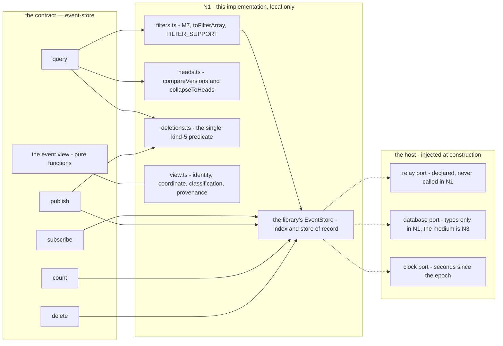
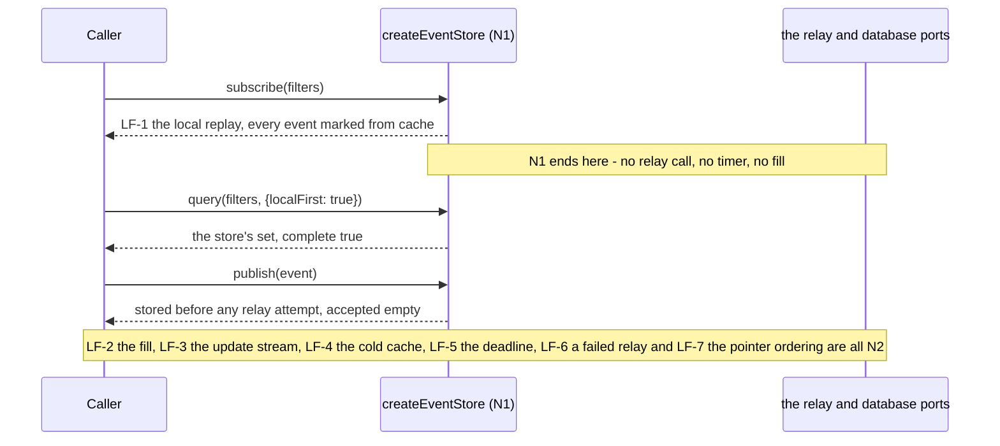

# event-store — the events the app has, and how a surface asks for them

**A spec first, an implementation second.** This directory is the module; `ts/` holds the first
implementation of it (the local half — no socket) and `evidence/` holds the commands that regenerate what
this document claims. The three of them are the module's whole content:

- **`ts/`** — the TypeScript implementation and its own inventory, `ts/ts.md`, with its own install root,
  its own runner and its own compiler configuration, so the module is checkable without its host.
- **`evidence/`** — `run.sh` (build, test and isolation evidence) and `falsify.py` (the non-vacuity run),
  each of which prints and is regenerated by the caller's redirection. Nothing here is hand-edited.

The module is **built, not extracted**: `platform-core` defines it at its final state, and the market's
`stores/ndk.ts` is the code it replaces rather than the code it comes from. Nothing in it reads this
repository, the app, or a host — every edge (the relay set, the database, the clock, the verifier) is
injected.

## The statements

One statement per behaviour, each a line of its own with its content-hash identity assigned by
`python3 core/checks/check.py --root . --assign` — never typed.

- `#3ff1b0` — The event store owns the app's event data and the way a surface asks for it: NIP-01 query, subscribe, publish and count, NIP-09 deletion and NIP-40 expiry, in and out as raw nostr-tools events.
- `#e9eec1` — This directory is a spec with many implementations (#465561): the TypeScript one in ts/ is the first, and a Rust, Angular or Flutter host realises the same contract without inheriting this one's idiom.
- `#8ff9af` — It is the successor to stores/ndk.ts's data half (#75322f): it owns no socket, it takes a resolved relay set at construction, and it knows nothing about wallets, signers or relay policy.
- `#3aac68` — The contract's nouns are NIP-01 query, subscribe, publish and count with NIP-09 deletion and NIP-40 expiry, its operations return promises, and an implementation's idiom is named as its declared exception (E1).
- `#9b7dd3` — The persistence seam's two types are the library's own IEventDatabase and IAsyncEventDatabase, adopted verbatim (E7), and the four-member block the spec prints is those types' write half rather than a second vocabulary.
- `#4f4cc6` — query returns QueryResult {events, complete} and never a bare array, because a bare array cannot carry "the deadline fired" and a caller renders a partial list as the whole answer.
- `#4757d0` — subscribe streams AsyncIterable<Event> with an unsubscribe that is idempotent, and the removal notification the spec requires is not yet typed: the stream emits insertions, and the gap is named rather than invented.
- `#b6c13c` — publish verifies the event and stores it before or independently of any relay attempt, and never depends on a relay accepting (M14): a publication no relay took is still a local write.
- `#d62f7c` — count counts the store and is never answered by fetching, and it reports approximate: false because an in-memory index is exact (E6); a wire COUNT belongs to a relay host, which this module is not.
- `#337e0c` — Two deletions are never conflated (M9): a local removal is temporary and restorable, a kind-5 deletion is durable and author-scoped, and NIP-40 expiry is neither.
- `#76a7a3` — Replaceable and addressable events resolve to one head per address, the greater created_at first and ties broken by the lexicographically lower id, with arrival order never deciding (M3).
- `#9b4105` — Identity inputs fail closed (M7): a malformed ids, authors, #e, #p or #P value rejects with reason 'rejected' and is never repaired, while an empty identity list is kept and matches nothing.
- `#004d63` — Provenance is contract-visible (M12): every event a read answers with satisfies isFromCache, so a caller can tell a locally answered result from a network-answered one.
- `#2c2e1b` — The increments are named rather than implied: N1 is the local half built here; the network phase, deadlineMs, complete:false, the Reason set and the ordering LF-1…LF-7 are N2; the persistence medium and the eviction floor are N3; the market's re-pointing is N4; nostrify is N5; a khatru host is N6.
- `#a6d035` — The declared exceptions are E1 rxjs Observable on the implementation's own dollar-suffixed members, E2 raw nostr-tools events, E3 the extended filter with this implementation's declaration, E4 pointer inputs, E5 reason-carrying errors, E6 the count flag and E7 the seam.
- `#e8d56c` — FILTER_SUPPORT and EvictionPolicy are values a test reads rather than prose: the first is E3's required declaration and the second is M10's, the four policy answers this implementation declares instead of implying.

## The shrink — amendments to the statements above (2026-09-29)

**Amended in the body, and every declaring line above is left byte-identical**, because a statement's identity is
the hash of its declaring line (`#c9ece3`) and every artifact in this tree that cites one would dangle if the line
changed. The re-cut is the maintainer's of 2026-09-29
(`runs/2026-09-29-event-store/notes/2026-09-29-io-seam-unifier-and-validation.md` §1–§2), its frozen bound is
`runs/2026-09-29-reframing/order.md`, and it is recorded in `platform-core/platform-core.md` §2 as `#818798` and
`#120968`. **The destination is named as `event-access/event-access.md`, by path, because a statement may cite
only `core`, itself or an ancestor, and `event-access` is a sibling module: its identities are deliberately not
cited in this document, and the same rule runs the other way.** Each bullet below names the statement it amends
and says what the re-cut changes about it.

- **`#3ff1b0` — the job.** Amended: the event data and the way a surface asks for it stay here, but the
  caller-facing operation surface leaves. This module keeps the **local truth** — the id-unique set of raw
  events, one head per address, the three kinds of deletion, provenance marking, counting from its own index and
  the event view — and exposes the **local read/write endpoint** those were composed from. The five verbs and the
  `{events, complete}` envelope are `event-access`'s.
- **`#8ff9af` — the successor to `stores/ndk.ts`'s data half, no socket.** Amended: the sentence "it takes a
  resolved relay set at construction" no longer holds — **the relay set and the relay port leave this module's
  contract entirely**, because a resolved relay set is what an IO seam is handed and this module has no seam in
  it. "No socket, no relay policy" is unchanged and is now structural rather than a promise.
- **`#3aac68` — the nouns and the promises.** Amended: the nouns are still NIP-01's, but the operations they
  describe are the endpoint's local read/write vocabulary; the promise-returning idiom and the rxjs exception
  travel with the operations to `event-access`'s implementation.
- **`#4f4cc6` — `query` returns `{events, complete}`.** Amended: `complete` is a fact about local-plus-relay and
  therefore leaves with the operations; the endpoint's local read answers with a set of raw events and makes no
  completeness claim, because with no network phase there is nothing that could be incomplete.
- **`#4757d0` — `subscribe` streams events with an idempotent unsubscribe.** Amended: the subscription that spans
  two tiers, and the removal-notification gap the statement names, are `event-access`'s; what stays here is the
  endpoint's **local change notification**, which is the local half a caller needs to see its own writes.
- **`#b6c13c` — `publish` stores before or independently of any relay attempt.** Amended: the rule survives
  exactly, and the relay half of it is no longer here at all — the endpoint writes locally, and whether a relay
  is asked and what it answered is a fact of the composition, which keeps the store-first rule.
- **`#d62f7c` — `count` counts the store and is never answered by fetching.** Unchanged in substance: the
  endpoint's count is the local index's, `approximate: false` remains honest, and the statement's closing clause
  ("a wire COUNT belongs to a relay host, which this module is not") is now the reason the caller-facing `count`
  operation is `event-access`'s and the reason `nostr-io` carries the wire one.
- **`#9b4105` — identity inputs fail closed (M7).** Amended: the guard stays here as **defence in depth** and stays
  the **single implementation** of the predicate (the repair in commit `fb304df`), while the **boundary** is
  `event-access`'s, because that is where filters enter the system. The two may not diverge, and the composition
  may not grow a second one. **Amended again 2026-09-30 (the orchestrator's decision D-O6):** the empty-list
  rule generalises to **every** `#`-key, not only the identity keys — it is adopted as the project's rule and
  stated as a new statement below — and **I3a landed on 2026-09-30**: `filters.ts`'s predicate now implements
  the general rule, so the specification and the code agree here and this statement is no longer the side that
  has to win.
- **`#004d63` — provenance: every read's events satisfy `isFromCache`.** Amended: unchanged for what this module
  answers, and no longer sufficient for what a caller sees — merged provenance (locally answered versus
  network-answered) is `event-access`'s, because one sticky bit on a shared instance cannot carry it.
- **`#76a7a3` — one head per address (M3).** Unchanged, and the statement gains a consequence: the composition
  renders on this rule and **may not re-implement it**, so this remains the module where the rule has exactly one
  implementation.
- **`#337e0c` — two deletions are never conflated (M9).** Unchanged: the three kinds stay here, and
  `event-access` routes a deletion to this endpoint without deciding it.
- **`#2c2e1b` — the increments.** Amended, and this is the correction the re-cut most needs: **N2 as it was
  ordered is void** — the network phase, `deadlineMs`, `complete: false`, the `Reason` set and LF-1…LF-7 are
  `nostr-io`'s and `event-access`'s increments, not this module's. The corrected map is below.
- **`#a6d035` — the declared exceptions.** Amended: E1 (rxjs on `$`-members) and E5 (reason-carrying errors) travel
  with the operations; E2, E3, E4, E6 and E7 stay, because the endpoint still hands out raw events, still takes
  the extended filter, still takes pointer-shaped refs, still flags nothing it cannot index and still declares its
  persistence seam as the library's types.
- **`#e8d56c` — `FILTER_SUPPORT` and `EvictionPolicy` as values.** Unchanged, and both stay here: the endpoint
  takes filters, so the declaration is still its, and the eviction floor is still the store's (M10).

The statements the shrink adds:

- `#f54c68` — The caller-facing operation surface this module held — the five NIP-01 verbs and the `{events, complete}` envelope — has moved to `event-access/event-access.md` on 2026-09-29, and the declaring lines above are amended in this body rather than rewritten because their identities are cited elsewhere in this tree.
- `#e472d3` — What this module keeps is the **local truth** and the **local read/write endpoint** a caller routes through: an id-unique set of raw events, one head per address, the three kinds of deletion, provenance marking, counting from its own index and the event view, with no relay set, no deadline, no completeness fact and no write-back policy.
- `#5dcce6` — The endpoint is **one shape that a relay and this store satisfy alike** ("the store is a local relay"), so what exists between this module and the IO seam is an endpoint a host plugs in and compatibility between them is configuration rather than coupling.

The orchestrator's decision of 2026-09-30 adds one statement (the general empty-list rule, D-O6):

- `#2e71c3` — A filter whose any `#`-key list is present and empty matches nothing and is answered as nothing, never dropped, for every `#`-key and not only the identity keys.

**Adopted by the orchestrator's decision D-O6 of 2026-09-30**
(`runs/2026-09-30-first-usable-version/decisions-orchestrator.md`). NIP-01's rule is the project's rule: a
filter whose any `#`-key list is present and empty **matches nothing and is answered as nothing, never dropped**,
and this holds for **every** `#`-key (`#d`, `#a`, `#t` and the rest), not only the identity keys (`ids`, `authors`, `#e`, `#p`, `#P`) the narrower repair already closed. It is a
genuinely new claim rather than a correction, so it is a **new statement** here and every declaring line above is
left byte-identical. **The code follows in increment I3a**: the one-line predicate change
(`event-store/ts/filters.ts`) plus its case and its mutation are I3a's — its own increment, so the shrink's
conservation arithmetic is not mixed with a behaviour change. **Until I3a lands, this module's implementation
holds the narrower identity rule** repaired in commit `fb304df`, and this module **claims nothing wider**: the
statement above is the rule the module is specified by, and the code reaches it at I3a.

**Amended 2026-10-01 — I3a has landed.** The increment the paragraph above anticipates is in the tree:
`event-store/ts/filters.ts`'s `matchesNothing` now implements the general rule — every present-and-empty
`#`-key, not only the identity keys — so the "until I3a lands" reading above now describes this document's
history rather than the directory. Nothing above is edited; this note is where the change is recorded.

## The operations, the ports they may use, and where N1 stops



The relay port is drawn dashed and un-implemented on purpose: it is **declared and never called** (M5, M14).
A `database?` is optional and its _types_ ship here; the medium is N3's, and a store with no database is fully
functional (M11).

**Amended 2026-09-29 — read the five operation boxes above as `event-access`'s.** The diagram is left as it was
drawn (its boxes are the pre-shrink contract) and this note governs it: `Q`, `S`, `P`, `C` and `D` are the
composition's now, and the **store's own diagram** is everything under `local` plus the one box the shrink adds —
the endpoint a caller routes through, whose members are a local read, a local write, a local count, a local
removal, the local change notification and the filter guard. The relay port box is deleted from this module's
contract rather than drawn dashed: with the operations gone, a store that still declared `relay?: RelayPort` would
be a store with a socket in its vocabulary.

**Amended 2026-09-30 — the orchestrator's decision D-O16**
(`runs/2026-09-30-first-usable-version/decisions-orchestrator.md`, round 2). The endpoint's **port shape is declared
by the consumer**: `event-access` prints it in `event-access/event-access.md` ("The two ports and this module's own
types, printed", the orchestrator's decision D-O12 of 2026-09-30) — the declared tier (E4), the local read, the
local write, the local count, the local removal, the local change notification (**now typed there**, where this
document's own statement leaves it typed nowhere) and the endpoint's own `keep*` read options. **Until I3, this
document's endpoint surface is prose** — exactly the members named in the paragraph above — and at **I3 this
endpoint adopts the shape `event-access` declares**, so I3 is a conformance job rather than a reconciliation.
**No declaring line of this document changes**, and the new statement `#2e71c3` stays as written.

**Amended 2026-10-14 — the store accessor, `modelStore()`.** The endpoint gains one member and **nothing
else**: `modelStore(): IEventStore` (`applesauce-core/event-store`) returns the **live library store the module
already constructs** — the store of record itself, not a snapshot and not a second store — so a vendor `Model`
can subscribe to it and a loader can write into it, and `read` answers exactly what that store holds. It is a
_visibility_ change only: the store was already inside the module and its construction, its options and its
`eviction` are untouched. **No relay member is added** — the relay set and the network phase are not this
module's (`#9f5778`), and the handle's own enumerable members remain the endpoint's plus the declared eviction
policy plus this one accessor, with `NOT_A_RELAY_EDGE` still absent from `Object.keys(store)`. `read` is a
structural `CacheRequest` (`Observable | Promise | Event | Event[]`) unchanged, so no adapter is needed at the
seam. The three cases live in `ts/store.test.ts`.

## The local-first ordering, and where N1's boundary is drawn



N1's reads are synchronous with the store: with no network phase, no phase can fail, so `complete` is `true`
for every read and `localFirst`, `deadlineMs` and `persist` are accepted and **not honoured** — the
increment's target → increment map names them beside the removal notification as N2's. The cold-cache case
(LF-4) is the network phase's question, and it is not answered here. A read-level `since`/`until` is carried
and not applied either: NIP-01's window is the **filter's**, and the read's own `limit` is the per-filter
fallback — leaving both filters' windows the store's to honour rather than the caller's to sort afterwards.

**Amended 2026-09-29 — LF-1…LF-7 are no longer this module's.** The sequence above was written while the network
phase was going to live here; the re-cut moves **the whole of it** — the fill, the update stream, the cold-cache
rule, the deadline, the relay-failure rule and the pointer ordering — to `event-access`, which asserts each step
on a named path, and moves the wire half to `nostr-io`. What stays here is the **first line of the sequence only**
(LF-1's local half: a local read answers from the store before anything else can be involved), and even that is
now a property of the endpoint rather than a step in a sequence. The corrected target → increment map follows.

## The target → increment map

| spec / invariant                                                         | increment                                                                                             | what this module does instead                                                                                                           |
| ------------------------------------------------------------------------ | ----------------------------------------------------------------------------------------------------- | --------------------------------------------------------------------------------------------------------------------------------------- |
| §4.10 LF-1…LF-7, `deadlineMs`, `complete:false`, the `Reason` set        | **not this module** — `event-access`'s, with the wire half `nostr-io`'s (`#120968`)                   | **N2 as it was ordered is void**: this module has no network phase, so it has no deadline and no completeness fact                      |
| the relay port, the resolved relay set, relay policy                     | **not this module** — `nostr-io`'s (`#9f5778`)                                                        | the port and the set leave the contract; the endpoint is handed nothing that speaks the wire                                            |
| §4.3's removal notification (a kind-5 arriving as a notification)        | **not this module** — `event-access`'s (its type is still the maintainer's, E7's sibling)             | the endpoint keeps a **local change notification**; the subscription that spans two tiers is the composition's                          |
| the caller-facing five verbs and the envelope, removed from this module  | **S1 — the shrink's spec half, written in this run; its code half landed 2026-09-30 as increment I3** | **the operations are gone from the code too**: `ts/` returns the endpoint and exports no verb, so the spec and the implementation agree |
| the local read/write endpoint the operations are composed from           | **S1's second half**                                                                                  | it exists in N1's code today; the spec names it as the module's contract surface                                                        |
| the persistence medium, `prune`, `AsyncEventDatabase`, M13's _drop_ half | **N3** (unchanged)                                                                                    | the seam's types only; a store with no database is fully functional                                                                     |
| the market's read path, and `persist:false`'s honouring                  | **N4** (unchanged in kind, re-pointed)                                                                | nothing of the market is touched; the market is re-pointed onto `event-access`, not onto this module                                    |
| the scheduler's nostrify boundary                                        | **N5** (unchanged)                                                                                    | named as a consumer, built elsewhere                                                                                                    |
| the khatru relay binding                                                 | **N6** (unchanged)                                                                                    | named as a consumer, built elsewhere                                                                                                    |

`prune`/`quota` are the host's as well: the policy is a declared value (`EvictionPolicy`), and nothing in N1
evicts — the read excludes, and never mutates the store. **The correction this table carries** is the one the
re-cut forces: the network phase is not this module's increment, so no row above claims a socket, a deadline or a
completeness fact, and the two rows that do are marked as another module's rather than as a later N-number here.

## Findings reported rather than repaired

Four things the first implementation cannot settle on its own, each recorded where it bites:

1. **E7 — the seam's vocabulary.** The spec's block prints four members while calling the two types adopted
   verbatim from the library; the library's interfaces are a read interface plus three writes. The module
   declares its two types **as the library's** (statement 5), which is the one-line amendment to §4.1 the
   increment carries.
2. **The removal notification has no type.** §4.3 requires a kind-5 deletion to arrive as a removal
   notification, and `Subscription.events` is `AsyncIterable<Event>` — a removal is not an event. This module
   **does not invent one** (statement 7). The obvious repair is a `SubscriptionEvent = Event |
RemovalNotification` union, which is a spec change and the maintainer's.
3. **`createReplaceableAddress(kind, pubkey, d?)` is not `kind:pubkey[:d]`.** The library's spelling ends in a
   **trailing colon** for a replaceable kind with no `d` (`kind + ":" + pubkey + ":" + (identifier ?? "")`), and
   the market's own `deduplicationKey()` does not. This module adopts the library's form so `getEventUID`'s keys
   and the strings it compares agree, states the exact strings in `ts/view.test.ts`, and reports the spec's
   comment as imprecise.
4. **NIP-50 is accepted and ignored, and that is a fail-open shape.** E3 requires the declaration and not the
   support, so `FILTER_SUPPORT` is `{ nip91: true, nip50: false }` and a `search` filter does not filter — the
   answer is the one the same filter without `search` gets. **Implementation note, measured:** the underlying
   index treats a `search` filter as matching _nothing_ (`applesauce-core` 6.2.0
   `dist/event-store/event-memory.js:383-386`, READ), while the predicate it is filtered by ignores the field —
   so passing the field through would make "declared, not supported" mean "matches nothing". The lookup is
   therefore given a copy of each filter without the key this implementation declares it does not honour, which
   is the order's own ruling (§0.4.4: _the unfiltered local superset_) and the case's own title
   (_accepted unhonoured_). Reported for a decision: declare-and-accept as the spec says, or reject fail-closed
   as M7 does for identity inputs.
5. **The shrink could not be completed in the front-matter from the spec half, and it has been completed at the
   code half — 2026-09-30, increment I3.** This document's front-matter named the pre-shrink surface while the
   re-cut's instruction was a **body** amendment and nothing validated `contract.*`, so editing those lists then
   would have been a claim about an entry that did not exist. That entry now exists: `contract.operations` names
   the endpoint's members, `contract.exports` and `contract.types` name what `ts/index.ts` delivers, and the diff
   between the lists and the entry is a check that runs green. The five verbs and the envelope appear in
   `event-access/event-access.md`'s lists instead, and **not** here.
6. **The predicate is exported now — 2026-09-30, increment I3, the orchestrator's decision D-O18.**
   `assertIdentityFilters` and `matchesNothing` are both named in `contract.exports` and delivered by
   `ts/index.ts`, so a consumer's fake can be a **differential** against this module's single implementation
   instead of a model of it, and a second implementation anywhere is a defect an export like this makes
   visible. The boundary stays `event-access`'s and the guard stays here.

## Evidence

Both scripts **print**; the caller redirects, so no script writes into this tree and each can be run twice:

```
bash event-store/evidence/run.sh      > event-store/evidence/01-build-and-tests.txt
python3 event-store/evidence/falsify.py > event-store/evidence/02-invariant-falsification.txt
cd event-store/ts && $HOME/.bun/bin/bun test          # 37 cases in 4 files
cd event-store/ts && $HOME/.bun/bin/bun run typecheck # tsc --noEmit, the module's own configuration
python3 core/checks/check.py --root .                 # the routine: 0 hard findings
python3 core/checks/evidence.py --root .              # the evidence lint: a ratchet, and it does not grow
```

`evidence/hash-refs.py` is the module-local **cross-reference verifier**. It resolves every six-hex token
in `ts/` against the statements this document and `ts/ts.md` declare — and against the module's ancestors,
as `core/checks/check.py` permits a citation — prints each token with the declaration text it resolves to,
and lists the declarations and the files no statement covers. It prints too, so the caller redirects it:

```
python3 event-store/evidence/hash-refs.py > event-store/evidence/03-hash-refs.txt
```

The last two are run from the assembly root. Two measured notes a reader should not have to rediscover:

- the module's compiler is the one it pins (`typescript ^5.6.0`, resolved 5.9.3). `bunx tsc` run from the
  **assembly root** resolves a different, registry-latest compiler (7.0.2, MEASURED: `bunx tsc --version`),
  which does not see `AbortSignal` from the bun types and reports four `TS2304` errors in `ts/types.ts`; run
  from `event-store/ts` it uses the module's own and exits 0. The module's own `bun run typecheck` is the
  authoritative form, and `ts/tsconfig.json` is the signer module's, verbatim, by the increment's order.
- the evidence lint's count is a **ratchet**: before this module's script exists it stands at 5 hard findings
  and 1 note (`runs/2026-09-28-signer/research/evidence/05-a0-remeasure.sh` and `signer/evidence/probe.sh`, both
  pre-existing), and today the lint reports 7 hard findings and 1 note — the two the module's own
  `event-store/evidence/run.sh` adds are **documentation false positives** at its lines 84 and 281, `echo` lines
  that name the redirect path the _caller_ performs, so the script still prints rather than redirecting: it sets
  `set -euo pipefail` in its first lines, spells `bun` absolutely and exports `PATH`, and asserts its subject
  before reading it.
