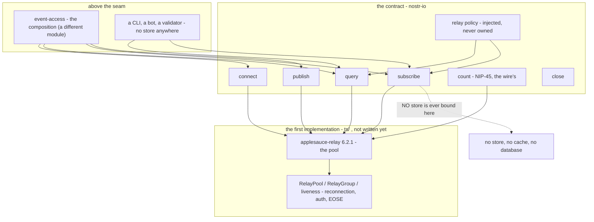
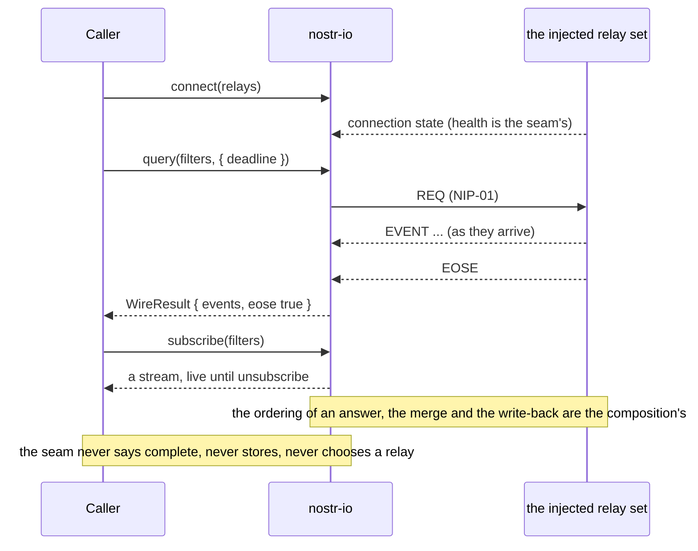

# nostr-io — the connection, the query and the publish point, with no store behind it

**The job, in one sentence** — own the wire: connect to relays, target them, query them, subscribe to them and
publish to them, and own the semantics those four run on (EOSE, retries, reconnection, connection health), **with
no store, no cache and no relay policy of its own**.

This document is the **spec**. `ts/` holds the first implementation — TypeScript, over `applesauce-relay`
6.2.1, which is an implementation of this contract and not the contract — and `evidence/` holds the commands
that regenerate what this document claims. Both directories exist: this run wrote the spec first, and the
implementation is the run's **first increment** (`runs/2026-09-29-reframing/order.md` §1). The module is named
`nostr-io` because `platform-core` names it that (`#9f5778`) and because a rename here costs every import path
later.

## The statements

One statement per behaviour, each a line of its own with its content-hash identity assigned by
`python3 core/checks/check.py --root . --assign` — never typed.

- `#e574c2` — `nostr-io` owns the wire: the connection, the relay targeting, the query, the subscribe and the publish, and the wire semantics they run on — EOSE, retries, reconnection and connection health — with no store, no cache and no policy.
- `#bf88e8` — This directory is a spec with many implementations (`#465561`): the TypeScript one in ts/ is the first, and the same contract is satisfiable by nostrify's NPool and by a Go relay host without inheriting either's idiom.
- `#7c608c` — It is the module `platform-core` names `nostr-io` (`#9f5778`), amended on 2026-09-29 to absorb the caller-facing operation surface: it is the destination of the market's `src/lib/nostr/io.ts` family, and it depends on no store.
- `#fbfce3` — The contract's nouns are NIP-01's — relay, filter, event, ack and reason — and its operations are connect, query, subscribe, publish, count and close, each returning a promise or a stream rather than an implementation's own handle.
- `#fa487d` — The pool request shape is adopted rather than invented: `NostrRequest = (relays, filters) => events` and `UpstreamPool = NostrRequest | { request: NostrRequest }`, read from the vendor's published contract at `applesauce-loaders` 6.2.0 `dist/types.d.ts:4-11` and surveyed at `runs/2026-09-29-event-store/research/05-applesauce-precedent.md`:126-128.
- `#c6ae9c` — The adopted shape is what makes the seam library-free as well as store-free: the vendor documents that same contract as satisfied by its own `RelayPool`, by `nostr-tools`' `SimplePool`, by NDK and by nostrify's `NPool` (`research/05-applesauce-precedent.md`:473-479), so a TypeScript host is wired the standard way and a Go relay host is not excluded.
- `#ba52de` — The remaining library type is a **named exception** (N1): the first implementation's stream type is rxjs' `Observable`, which is the vendor contract's own shape, and a second implementation types its stream as its own equivalent and adapts at its boundary.
- `#010fc8` — **No store is injected here and none is kept** (M5, the seam half): the module works with zero endpoints that are not relays, and a fetch that stores nothing is a legitimate composition of it.
- `#d700bc` — The store-free guarantee is a **structural** claim proved by construction, not by a grep: a hand-written pool records every call and throws from every method, and the case requires the wire operations to resolve against a second, non-throwing pool **and** requires the recording pool's call count to be zero when the seam is asked for nothing.
- `#4dab02` — The import allow-list is the second half of the same claim, with its expected hits stated: every specifier in ts/ is module-relative or one of the seam's own declared dependencies, and no store, database or cache package may appear.
- `#06200d` — Relay policy is **injected, never owned**: the relay set arrives as the host's answer to "which relays" on every call, and the module may not add, prefer, reorder or blacklist a relay beyond the wire's own reconnect behaviour.
- `#5ecac1` — The reasons and outcomes a caller can observe are named (N4): a refusal is a value from a stated reason vocabulary, never a bare string and never a silent absence.
- `#ae22a4` — `publish` reports **one ack per targeted relay**, each carrying that relay's own answer, and performs no local write: an event no relay accepted is not stored by this module, because what gets stored is the composition's policy and not the seam's.
- `#10b5ac` — `query` resolves with what arrived and whether the wire's boundary was reached, and it never invents completeness: telling a cold answer from a complete one is the composition's fact, so the wire reports EOSE and stops there.
- `#15aa73` — `subscribe` owns the subscription's lifetime and its cancellation is idempotent: `unsubscribe()` twice closes once and throws nothing, and a relay failure inside a live subscription is reported on the error channel rather than ending the caller's stream silently.
- `#d433f1` — The **verb-set asymmetry** is named rather than papered over: the transport side has NIP-45 `COUNT` and the store side has no count at all, so a wire count and a local count are two different operations, and this module carries the wire one while the composition's own `count` is the local one.
- `#752c02` — The wire count reports whether the relay's own index was approximate, because NIP-45 permits approximation and the contract requires the flag rather than the accuracy.
- `#3a5789` — **Local-first is not this module's rule**: the seam's reads are wire reads, and the ordering a caller observes is the composition's normative sequence, named here so that no capability of one path is ever stated as "supported" for the seam.
- `#ec6c90` — The vendor's own paths disagree with each other — its pointer path orders cache, then relay hints, then extra relays, while its timeline path is a concurrent merge — so this spec states the paths it covers and carries no ordering claim at all.
- `#1cda80` — The module's independence is a fact about imports and ports rather than about prose: no host alias, no framework, no browser global and no app import (M6), which is the same criterion the signer's evidence script already states as an allow-list.
- `#d5e076` — The **stop conditions** are stated so a reviewer can falsify them: a sentence in this spec that needs a store, a cache or a host import is an **architecture contradiction**, and so is one that would make the seam compute a head rule or a filter predicate the store is supposed to own.
- `#f2a631` — The **target → increment map** is named rather than implied: this run delivers the spec alone, the first increment delivers ts/ against it, and everything else this module could be is listed below as not delivered.
- `#8899c6` — The declared exceptions are N1 rxjs' `Observable` as the adopted stream shape, N2 raw `nostr-tools` events as the event view, N3 the reason vocabulary as a string union rather than one error class per condition, and N4 relay URLs as plain strings rather than a library's relay handle.
- `#7bf6f6` — The evidence obligations are stated as criteria: the store-free case, the second-backend case (the same conformance suite over another pool adapter), and one case per path this spec covers, asserted by call order on a recording pool rather than by timing.
- `#bbfa5c` — What is genuinely ours is named in one line, because a module whose library already owns the seam would be a wrapper: the specified contract, the store-free guarantee, the reason and outcome mapping, the injected relay policy, and the multi-backend proof — the vendor supplies sockets, not the contract.
- `#3820a9` — The module holds no global state and no singleton pool: two composers may run two seams in one process without sharing a socket, a subscription or a relay set.
- `#0a568f` — It is not the relay _host's_ module either: a relay host satisfies the same contract from inside the wire, and the difference between the two is configuration rather than code.
- `#751387` — A single read retains at most a **stated ceiling** of 10 000 events, declared as an inspectable value rather than a number buried in a branch: at the ceiling the seam stops reading and reports `eose: false`, because the wire's boundary was not reached.
- `#e5dbdb` — `deadlineMs` is a **wall-clock budget on the whole read** rather than an inactivity gap: a wire that keeps emitting without ever reaching EOSE is stopped by it just the same, and a read it stops reports `eose: false` like any other read that did not reach the boundary.
- `#fdc27c` — The wire count over a target set is the **sum** of the targeted relays' own indices, reported `approximate` whenever any relay answered approximately, and a relay that refuses or times out its own `COUNT` refuses the whole operation rather than being silently omitted from the sum.

**Amended in the body, 2026-09-29, after the red-team pass.** Six statements are affected and **not one declaring
line is edited**: a statement's identity is the hash of its declaring line (`#c9ece3`), and both reviews of this
increment, the increment order and the evidence captures cite those identities, so an edit would dangle all of
them. The two new statements of that pass are the second- and third-to-last bullets above; the amendments are the
text of §"Amendments, 2026-09-29" below.

**Amended again in the body, 2026-09-30, after the blind final pass.** The D1/D12 repair
(`runs/2026-09-29-reframing/decisions-micro-harden-nostr-io.md`, findings B1 and B2 of
`runs/2026-09-29-reframing/review/final-blind-nostr-io.addendum.md`) adds **one** statement — the last bullet
above, `#fdc27c`, what a wire count over a set is (D2) — and two readings, both in the body and neither in a
declaring line: the count's reduction rule answered under `#752c02`, and what a read waits for when no deadline
bounds it, answered under `#10b5ac` (D8). Nothing is removed, no declaring line moves, and the front matter is
unchanged: `CountResult` keeps its two members.

## Amendments, 2026-09-29 — after the red-team pass, in the body only

**Authority:** the adjudication of the two blind reviews of the frozen increment
(`runs/2026-09-29-reframing/adjudication-nostr-io.md`), whose §2 rules on what a refusal is, §3 disposes of each
finding and §4 bounds this repair. **Nothing here widens the module.** No sentence below grants a store, a cache,
a relay of the module's own or an invented answer; every one of them narrows what a caller can observe to what
the wire actually did. The statements above are unchanged, and each amended one is quoted by its identity and
answered here rather than rewritten — a repair that edits a declaring line renames an identity that this run's
reviews, its increment order and its evidence already cite (`#c9ece3`).

### `#5ecac1` — a refusal is a value _on the channel the operation has_, and every failure path is typed

The sentence stands and is now **total**, which is what the reviews found it was not. Four things are added.
**(a) Where a refusal lands.** The operations with a promise carry refusals in the answer they already return:
`WireResult.failures` is the read's failure channel, beside `events` and `eose`, and each entry is the module's
own typed refusal with a `reason` from the vocabulary. `subscribe` carries them on `errors`, as before.
**(b) What rejects.** A rejection through the module's own mapping is for the **caller's own errors** — a
malformed filter, a relay policy that cannot answer, a relay set the transport cannot open. A relay's own
refusal does not reject a read, and a policy the host cannot answer with never reaches the wire.
**(c) No bare `Error`, anywhere.** A pool that throws, or whose own `events`/`eose`/`failures` stream dies, is a
refusal like any other: it is mapped through the module's own function, the live `errors` channel delivers a
value from the vocabulary, and the caller's `events` stream delivers what arrived and then ends — it never ends
on a library `Error`. The channels the contract types as `RelaySeamError` therefore deliver one.
**(d) The mapping reads the relay's own words.** NIP-01's machine-readable prefixes (`auth-required:`,
`rate-limited:`, `error:`) reach the vocabulary on the vendor path as well as on the adopted one: the vendor's
relay layer throws them and its group layer hands the throw over as an error message, so the implementation
reads that error's own reason instead of answering one generic rejection for every relay. This is the one place
the earlier text was over-broad rather than merely silent, and it is the reason `auth-required` and
`rate-limited` were unreachable through the vendor's own layer.

### `#15aa73` — the live channels are typed, and `closeOnEose` ends the stream **after** what preceded it

The sentence stands; what changes is how total it is. A pool whose own failure channel dies is not an exception
to "a relay failure is reported on the error channel rather than ending the caller's stream silently" — the
refusal is delivered **as a value on that channel**, which is the reading the channel's own type implies. An
`eose` stream that dies under `closeOnEose` is the same refusal, and the caller's stream ends completed rather
than errored. And `closeOnEose` ends the stream **at** the wire's boundary, not before the events that preceded
it: a pool that already holds its EOSE must still deliver the events the boundary followed, which the
implementation gets by subscribing the source before the boundary gate. Cancellation stays idempotent — one
teardown, twice-called, nothing thrown.

### `#10b5ac` — what a refusal mid-read does to a read

`query` still "resolves with what arrived and whether the wire's boundary was reached", and the reviews found
the refusal path had no reading at all. The reading, ruled by the adjudication and implemented here, is four
parts. **1.** A named relay refusal mid-read **never rejects the read**: `query` resolves with the events that
arrived and `eose: false` — the boundary was not reached — and the refusal is carried as a value on `failures`.
Events that already arrived are **never discarded** because a later relay refused. **2.** A rejection is for the
caller's own errors, as `#5ecac1` now says. **3.** Every failure path is typed, on the operation and on the live
channels alike, because a bare `Error` reaching a channel the contract types as its own refusal is a type lie
rather than a matter of style. **4.** The **same scripted wire produces the same outcome shape on both
conformance backends** — a case that changes its answer when the backend changes is two behaviours with one
name, and the suite drives the refusal script over the vendor adapter and over the hand-written pool and
compares the two outcomes object for object. The ceiling statement above belongs here too: the read is bounded
at a stated number of events, so a relay that never stops talking cannot grow one array without bound, and a
read stopped by that bound reports `eose: false` exactly as a read stopped by its deadline does.

**And what the read waits for when nothing bounds it.** The read completes when every targeted relay reaches the
boundary — that is the adapter's own gate, `takeWhile(() => seen.size < target.length, true)` — so a caller who
passes no `deadlineMs` and whose relay never reaches EOSE simply waits, and what bounds that in practice is the
transport's own per-relay timeouts (the vendor's `eventTimeout` 10 s and `pingTimeout` 20 s, **READ** in
`applesauce-relay` 6.2.1 `dist/relay.js`, not executed), never a bound this module invents.

### `#06200d` — the relay set is de-duplicated, and de-duplication is not a preference

The injected policy is still read on every call and its relays are still neither added, preferred, reordered nor
blacklisted. One narrowing is stated: the set handed to a pool is the **unique** one — a URL the host named
twice is handed once, in the host's own order, and dropped nowhere else. De-duplication is none of those four
things, and without it a repeated URL is the same relay asked twice on the wire: every event arrives twice and
the boundary that is counted per relay is never reached, so a read waits for an answer that is not coming. Two
spellings of one relay are **not** merged: the relay set is the host's answer, and rewriting the host's spelling
would be the module choosing a relay's name. The implementation keeps this predicate in **one** place — where
the policy's answer is read — rather than a second copy inside a pool, because two implementations of one
predicate is how the two drift.

### `#e574c2` — the policy is owned here, the mechanism is not, and `connect` is a status read

The claim that this module owns "the wire semantics they run on — EOSE, retries, reconnection and connection
health" is imprecise about one of the four, and this is the amendment. **What is ours:** the **policy** — where
retries, reconnection and health are declared, injected and bounded (the relay set is read from the host on
every call, the read's ceiling and the caller's wall-clock deadline live here, and the outcomes a caller sees
are the contract's own), and the **contract** around them. **What is not:** the **mechanism**. The first
implementation passes no options to the vendor's pool, so how many times a dropped socket is retried, how long
it waits and whether a REQ is re-sent are `applesauce-relay` 6.2.1's own defaults, read in the installed copy
(`dist/relay.js`, `DEFAULT_RETRY_CONFIG` and the relay's option fields): three connection retries with a
one-second linear backoff, no resubscribe after a clean `CLOSED`, a relay-scoped request reconnect, a ten-second
event timeout, a thirty-second publish timeout and keep-alive, and a twenty-second EOSE ping timeout. A version
bump may move those numbers; nothing in this spec claims one of them as a guarantee, and a host that needs its
own numbers configures its own pool, because the pool is injected. The seam's part of the same sentence is that
a _refusal_ arriving from any of that is a value (`#5ecac1`) and that the read's bounds are its own.

**And what `connect` actually does.** The operation reports the health of the relay set as the pool observes it,
read under the URL the pool files a relay by (its normalised form) rather than the spelling the policy used — so
a relay the pool holds is reported as it is, and a URL that is not a relay at all is a typed refusal rather than
an invented "not connected". It **dials nothing and waits for nothing**: the vendor pools lazily, so a fresh
seam reports every relay as not connected, and that is a true report of the pool's state. A second
implementation whose host wants a dial or a readiness wait may have one, but the contract's promise is the
report, and this sentence is the promise the TypeScript implementation is held to.

**The amended identity (R1, 2026-10-03).** The base line above is superseded on one point: it names "the wire
semantics they run on — EOSE, retries, reconnection and connection health" as owned here, and the amendment
above removes the **mechanism** from the module while keeping the **policy**. The base declaring line is not
edited — the fan-out writes the amended requirement as a new statement with its own identity, and the
implementation cites the new one; the old identity survives as history, cited only by this paragraph that
explains the move.

- `#b14090` — `nostr-io` owns the wire's **policy** and the contract around it — the relay set read from the host on every call, the read's ceiling and the caller's wall-clock deadline, and the outcomes a caller observes — while the wire's **mechanism** (retries, reconnection, connection health, the transport timeouts) is the injected transport's, so `connect` reports the pool's observed state and dials nothing.

### `#752c02` — what a wire count over a set is, and why the sum is over relays

The statement above stands — the contract requires the approximation flag rather than the accuracy — and the
reading of _what the count over a set is_ was never stated, which is the gap `#fdc27c` fills (D2). The
rule is the **sum** of the targeted relays' own indices, `approximate` whenever any one of them answered
approximately, and a relay that refuses or times out its own `COUNT` refuses the whole operation rather than
being quietly dropped from the sum. It is stated because the vendor's record is **per relay**: the group's count
is `relays$.pipe(switchMap(combineLatest(…)), share())` (`applesauce-relay` 6.2.1 `dist/group.js`), keyed by each
relay's own `url`, and `combineLatest` is **all-or-nothing** — it emits only once every targeted relay has
answered. So a wire count is a fact about relays and can never be presented as a distinct-event count; two relays
that both hold the same event are two indices, and neither the seam nor the vendor merges them. The un-updated
half is named: `CountResult` does not move, no declaration line is edited, and the sum is asserted on both
conformance backends by the case that tests the non-completing COUNT stream.

## Statements minted on the 2026-10-03 fan-out

The convention was fanned out to this module (`runs/2026-10-02-content-addressing/FANOUT.md`). Rule 4 minted
the statements the code needed and this spec had not stated: a declaration carried no statement narrow enough
to require it, and a rule that means _exactly one implementation_ now carries the `[1:1]` marker so the count
is testable rather than prose. No declaring line above is edited; these are additions only.

- `#499675` — The pool files a relay under its own normalised URL and the seam compares relay identities under **exactly one** normalising predicate `[1:1]`: health, the publish-ack match and a read's per-relay boundary count all use it, and it is never applied to the spelling the host gave.
- `#7a5f39` — A relay's own refusal text becomes the contract's reason in **exactly one** pure place `[1:1]`, mapping a NIP-01 prefixed `CLOSED` to the vocabulary without a socket.
- `#d7b4db` — NIP-01's filters are one-or-many and the pool always takes many: a single filter becomes a one-element array, an array a shallow copy in the host's order, and anything that is not an object is a typed refusal rather than a silent coercion.

## Where the seam sits, and what may cross it



`nullx` is drawn on purpose: the arrow that must never exist is the one from a subscription into a store. The
seam may not carry `eventStore`-shaped options, however optional a library makes them — the vendor's own
`request`/`subscription` accept one for deduplication and default to a throwaway in-memory store
(`research/05-applesauce-precedent.md`:563-567), and passing it through would make the store-free property a
convention instead of a fact.

## One wire read, and where the seam stops



The two notes are the boundary. `complete` is a fact about local-plus-relay, so it belongs to the module that
holds both tiers; the seam reports the wire's EOSE and nothing more.

## The target → increment map

Nothing below is delivered by this run: the run writes the spec. Each row names the increment that would carry
it, and every increment named here is one of this reframing run's (`runs/2026-09-29-reframing/order.md` §1) —
never a wish.

| spec surface                                                                                                                                                  | increment                                      | what exists instead, today                                                          |
| ------------------------------------------------------------------------------------------------------------------------------------------------------------- | ---------------------------------------------- | ----------------------------------------------------------------------------------- |
| `ts/` — the seam over `applesauce-relay` 6.2.1, its own install root and its own compiler configuration                                                       | **I1 — this run's first increment**            | nothing: this document                                                              |
| the store-free case (a recording, throwing pool), the import allow-list with its expected hits, the second-backend case                                       | **I1**, as that increment's acceptance surface | nothing: §"Evidence obligations" is the criterion, unexecuted                       |
| the reason and outcome mapping, the idempotent cancellation case, the call-order cases per path                                                               | **I1**                                         | nothing                                                                             |
| **not** delivered here, and named so nobody reports it: the local-first ordering, the merge, the write-back policy and `complete`                             | **I2 — `event-access`**                        | they belong to a different module by `#120968`                                      |
| **not** delivered here: the store's local truth, its endpoint and its head rule                                                                               | **I3 — the `event-store` shrink**              | the store is built (`#75322f`, re-scoped 2026-09-29) and owns them                  |
| **not** delivered here: content validation                                                                                                                    | **I4 — `validation`**, spec only               | a separate module, its own document                                                 |
| **not** delivered here: NIP-77 negentropy sync, NIP-42 flows beyond the pool's own handshake, outbox or relay-selection policy, a durable log of relay health | named, later or out                            | the module may not own relay policy (`#9f5778`) and this increment does not add one |

## Evidence obligations, as criteria

Each one below is written as a criterion rather than as an intention, because the increment that lands `ts/`
will be judged against these sentences and not against a summary of them.

1. **The store-free case (M5, seam half).** A hand-written pool that records every call and **throws from every
   method** is injected; the case drives `query`, `subscribe` and `publish`, requires each to behave as specified
   against the seam, and asserts the recorded call count. A seam that constructs a store, opens an internal
   cache, or binds the library's optional `eventStore` option fails here.
2. **The import allow-list.** Every import specifier in `ts/`, sorted and unique, is module-relative or one of
   the seam's own declared dependencies; the expected hits are stated rather than a bare zero, and a specifier
   that is neither is a finding. This is the signer's own criterion, applied here.
3. **The multi-backend case.** The same conformance suite runs over a second pool adapter, and a capability is
   claimed as supported only on the paths that case exercised — never for the seam as a whole.
4. **One case per path.** `query`, `subscribe`, `publish` and `count` each get their own case, and the ordering
   claims that exist anywhere in this document are asserted **by call order on the recording pool**, never by
   timing.
5. **The socket-primitive grep, with its expected hits stated.** The seam is _allowed_ to name socket primitives,
   because it is the module that owns the wire — so a bare zero would be a false criterion and is not stated
   here. What it may not do is own relay policy: the case is the injected policy being read at every call site
   that targets a relay.

**Amended 2026-09-29, after the red-team pass:** two criteria are added, and the first five stand unchanged.
Each one names the careless implementation it fails on, and each fails against the increment's frozen
implementation — that red half is `evidence/04-before-the-repair.txt`, and each case carries a mutation of its
own in `evidence/02-invariant-falsification.txt`.

6. **The refusal paths, per path and per backend.** A relay refusal that arrives **mid-read** resolves the read
   with what arrived and `eose: false`, the refusal as a value on `failures`, and the _same_ scripted wire
   produces the same outcome object over the vendor adapter and over the hand-written pool; a relay's own
   NIP-01 prefix (`rate-limited:`, `auth-required:`) reaches the vocabulary on both paths; a pool whose own
   `events`, `eose` or `failures` stream dies reaches the caller as a typed refusal and never as a library
   `Error`; and a host policy that cannot answer refuses every operation without reaching the wire.
7. **The module's own bounds.** A read retains at most the stated ceiling of events and reports `eose: false` at
   it, and a wire that keeps emitting without reaching EOSE is stopped by `deadlineMs` — a wall-clock budget on
   the whole read — rather than by an inactivity gap that a dripping relay never trips. Relay health is reported
   from the pool's own state under the key the pool files a relay by, and a URL that is not a relay is a typed
   refusal rather than an invented "not connected".

## Evidence

The scripts **print**; the caller redirects, so none writes into this tree and each can be run twice
(`core/checks/evidence.py`):

```
bash nostr-io/evidence/run.sh          > nostr-io/evidence/01-build-and-tests.txt
python3 nostr-io/evidence/falsify.py    > nostr-io/evidence/02-invariant-falsification.txt
python3 nostr-io/evidence/hash-refs.py  > nostr-io/evidence/06-hash-refs.txt
cd nostr-io/ts && $HOME/.bun/bin/bun test          # the module's own suite
cd nostr-io/ts && $HOME/.bun/bin/bun run typecheck # tsc --noEmit, the module's own configuration
python3 core/checks/check.py --root .              # the routine: 0 hard findings
```

`evidence/hash-refs.py` is the module-local **cross-reference verifier** — the fan-out of
`event-store/evidence/hash-refs.py`. It resolves every six-hex token in `ts/` against the statements this
document and `ts/ts.md` declare (and against the module's ancestors, as `core/checks/check.py` permits a
citation), prints each token with the declaration text it resolves to, separates a **fulfilment** citation
from a **provenance** one (the `(provenance)` marker of FANOUT R2), and lists the declarations and the files
no statement covers. A declaration living in a file the front matter above names `test-support:` is exempt
(FANOUT R3) and is reported as exempt rather than as a question.

Two asset families under `visuals/webui/` are pinned bytes rather than prose, so no comment reaches them and
this sentence is their accounting: `visuals/webui/README.md` (the page's own notes and file table), and the
vendored GSAP 3.12.5 `vendor/gsap.min.js` beside its `vendor/ScrollTrigger.min.js` plugin, vendored so scroll
motion never depends on a CDN. `visuals/webui/index.html` and `visuals/webui/SKILL.md` are named in the front
matter above.

## Findings reported rather than repaired

1. **The verb-set asymmetry is a real gap, and it is named rather than closed.** NIP-45 `COUNT` exists on the
   transport side and the store has no count of its own (`research/05-applesauce-precedent.md` §4 lists the
   library's loaders and their missing `count`; the store's own increment recorded the same absence). This spec
   carries the wire count, states that the composition's `count` is the local one, and does **not** make the two
   one operation. Whether the composition's `count` should ever consult the wire is `event-access`'s decision,
   and `event-access` says no (`M14`: counting never fetches).
2. **The vendor's composition layer is not the shape this seam is in** — it is a layer _above_ a pool, and its
   own write-back is a caller-side operator applied by 4 of 11 loader modules (`research/05-applesauce-precedent.md`
   §4, MEASURED there). That is the reason `event-access` exists, and the reason this spec does not adopt
   `applesauce-loaders` as a contract anywhere.
3. **The pool's optional store parameter is a defect surface for us, and it is named as one.** The vendor's
   `request`/`subscription` take an optional `eventStore` for deduplication and default to a throwaway
   `EventMemory` (`research/05-applesauce-precedent.md`:563-567, READ at `applesauce-relay` 6.2.1
   `dist/types.d.ts:141-142`, `:148-149`). The seam leaves it unset, and that sentence is N1's reason to exist:
   without it the store-free property would be a habit rather than a rule.
4. **`UNVERIFIED` and stated as such:** nothing in this document was measured against `applesauce-relay` 6.2.1's
   bytes in this assembly. The vendor claims cited above are `READ` from the survey, which read a sibling
   worktree's copy and cross-checked the version against the registry; the survey's own caveat is at
   `research/05-applesauce-precedent.md`:19-22. The increment that installs the package re-reads those lines in
   the installed copy before any criterion cites them. **Amended 2026-09-29:** that increment has landed, and the
   lines this document's repair depends on were re-read in the installed copy — the relay layer's
   NIP-01-prefix table and the throw it raises, the group layer's conversion of that throw into an error
   message, the retry and timeout defaults quoted under `#e574c2`, and the pool's normalising URL helper. Those
   four citations are `READ` at `applesauce-relay` 6.2.1 / `applesauce-core` 6.2.0 in `nostr-io/ts/node_modules`;
   the rest of the survey's vendor claims keep the `UNVERIFIED` label above, and no test in this module reaches
   a socket to confirm them.

## Open, and left open on purpose

`#6a5bcb` — **The reason vocabulary's exact members** are this run's proposal and the maintainer's to rename in one word: they are the wire's conditions (`auth-required`, `rate-limited`, `timeout`, `not-found`, `closed`, `rejected`) and the composition surfaces them through its own operations by importing this contract, not by citing this document.

`#bcb94d` — **Whether the seam exposes a relay-observation surface** (per-relay health, last error, last EOSE) as contract, or leaves it as the implementation's own members: the interface is cosmetic until a host asks for it, and the increment should ship the smaller surface.
