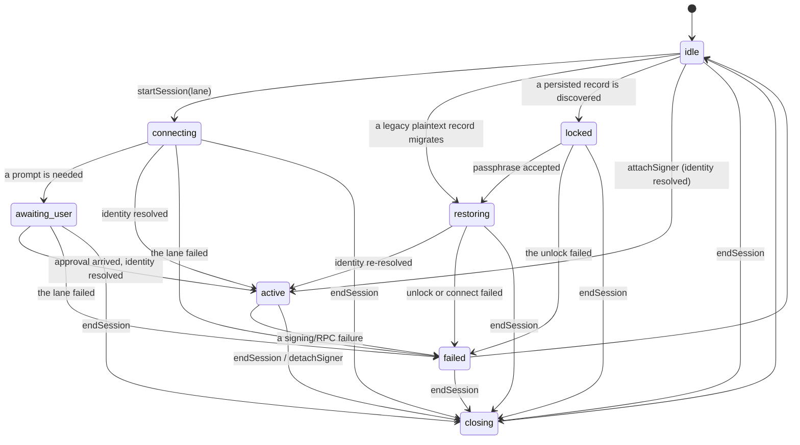
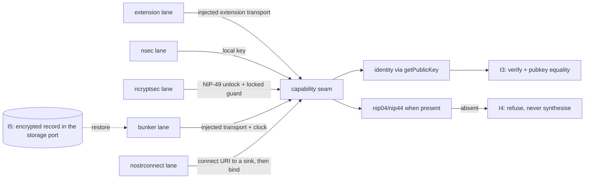

# signer — who the user is, what may be signed for them, and the session that makes both true

**The job, in one sentence** — resolve who the user is, sign events for that identity under an explicit
capability model, and own the session that makes both true, on any host, with the relay transport, the storage
backend, the clock and the cryptographic primitives injected by whoever composes it.

This document is the **spec**; `ts/` is its **first implementation**, TypeScript, harvested from the market at
`4bc7f8c0` and credited below. It names its own directory `signer` rather than `authentication` by the
maintainer's decision of 2026-09-28: his word for this module is "the signer", and the module's job is signing
events — `authentication` names one of the consequences of that job, not the job itself. `platform-core`'s
statement `#815e0d` still carries the older word; that naming lag is recorded here rather than edited into
another module's statement, because a statement's identity is the hash of its own line.

## 1 · The premise, as recorded

### `#83d0a1` — This module is new and independent; the market's signer code is the surface it replaces

`platform-core` (`#815e0d`, quoted in its own words at `platform-core.md:192-195`) records the maintainer's
direction of 2026-09-28: _"a core module is **new and independent**, specified at its final state — it is not
extracted from the market's current code. What is listed above is the code being **replaced** and the surface
its first consumer has to re-point onto the module's contract."_ `project.md` (`:34-36`, same date) says it
again: _"five core modules at their final state, not at their today-state, each platform-agnostic and each a
new, independent module rather than an extraction of the market's current code."_

So this module is specified at its final state. Its first implementation is a **credited harvest** of an
existing, tested implementation of these invariants — not an extraction from the market's app, and not a
migration the module inherits.

### `#97255f` — The maintainer's decisions this build records: the reference is `origin/master`, and the module stands alone

Taken on 2026-09-28, and they override the run's earlier assumptions:

- **`origin/master` (`4bc7f8c0`) is the reference.** It holds the best state of the signer work: the registry,
  the capability seam, the session vault, the NIP-46 lanes, the NIP-49 lane, `applesauce-signers@6.2.2` and the
  tests that name I1–I5. `origin/auctions` carries none of them.
- **There is no auctions-line integration, and no market integration of any kind.** Nothing in this module
  imports the market, is imported by it, or patches it. The market is mounted read-only and untouched.
- **The module is a single directory in this assembly** — `signer/`, with its spec at `signer/signer.md`, its
  first implementation in `signer/ts/` and its evidence in `signer/evidence/`.
- **The interfaces come first, for any consumer.** The public contract is the primary artifact; a consumer is
  hypothetical by design and that is accepted. The named consumers in the front-matter are honest: one is being
  _replaced_, one is another kind of composer the code already supports, and the rest do not exist yet.
- **The naming and the layout are decided and written down here** — `signer` for the module (above), `ts/` for
  the first implementation, because a spec has many implementations and `ts/` is one of them (`#465561`).

### `#f844ed` — The harvest is credited, and it is not this project's own code

The first implementation began as a harvest of `PlebeianApp/market` at `4bc7f8c0`, from these paths:

- `src/lib/nostr/signer-capability.ts` → `ts/capability.ts` (the capability seam and its guards)
- `src/lib/nostr/signer-registry.ts` → `ts/lanes.ts` (the NIP-07 and nsec lanes; the attached-capability
  singleton is gone — see §6)
- `src/lib/nostr/password-signer-session.ts` → `ts/lanes.ts` (the NIP-49 lane and its locked-deadlock guard)
- `src/lib/nostr/nostr-connect-uri.ts` → `ts/uri.ts` (the `secret`-param rule, unchanged)
- `src/lib/nostr/nostr-connect-signer.ts` → `ts/nip46.ts` (the strict bind, the deadlines, the RPC wrapper)
- `src/lib/nostr/nostr-connect-session.ts` → `ts/nip46.ts` (rehydration from a session token)
- `src/lib/nostr/session-vault.ts` → `ts/vault.ts` (the envelope, the iteration floor, the read-once migration)

`ts/session.ts` has no counterpart in the market: the market keeps its session inside `src/lib/stores/auth.ts`,
which is the surface this module replaces. `src/lib/nostr/ndk-signer-adapter.ts` is **not** harvested and is
not part of this module — it exists only to keep one library's typed consumers compiling.

### `#bfd03f` — Why the module exists before a consumer does: the modules are directed at their final state, and the consumers that exist today are named honestly

The rule of two says one consumer keeps a piece where it is and two hoist it, and this module's consumer set is
a **direction, not an observation**: the maintainer directed the module graph at its final state, where a
signer module exists for hosts that do not exist yet, so this module was specified and built before anything
imports it. The consumers that do exist today are named honestly and none of them is a second real consumer: a
marketplace app whose signer code is the surface being **replaced** (it still holds that code; this build did
not touch it, and nothing there imports this), and a non-UI composer — a CLI or validator that builds a signer
from a key with no session — which the market's own scripts already are in kind, and which is **named, not
built against this module**. The Angular, Rust and Flutter hosts the maintainer named do not exist at all.

What that costs, stated rather than implied: nothing proves this contract is usable by a real composer, and the
first consumer will find the places where it is not. What it buys: the contract is written and executed before
any consumer has a chance to shape it by accident.

## 2 · The contract

### `#8a5718` — The contract is thirteen session operations, one session-less entry, the spec's types and typed refusals

`createSignerSession(deps)` returns a `SignerSession` whose members are the thirteen operations below, in the
spec's own words. `createSignerFromKey(material)` is the module's other entry: the spec makes it
**session-less** ("no session, no UI, no storage"), so it is a function rather than an operation. Everything
else `ts/index.ts` exports is the vocabulary this document defines (ports, states, settings, snapshots) or a
typed refusal.

**The thirteen, each as an obligation:**

- `getPublicKey()` — the authenticated identity's hex pubkey, resolved **through the signer**. This is the only
  identity read (I2).
- `signEvent(template)` — sign a prepared unsigned event, **bound to the resolved identity**: the result must
  verify cryptographically _and_ `event.pubkey` must equal `getPublicKey()`, else fail closed (I3).
- `capabilities()` — the encryption the signer actually provides, after the composer's allow-list. Present if
  and only if the signer provides it and the composer permits it (I4) — and the same intersection is what
  `currentSigner()` hands out, so the capability a consumer reaches for cannot offer a scheme the operations
  refuse. "Present" in this document always means **both** reads.
- `startSession(input)` — one entry per lane: extension (NIP-07), nsec, NIP-49 ncryptsec, NIP-46 `bunker://`,
  NIP-46 `nostrconnect://`.
- `endSession()` — run the capability's teardown, clear the per-user derived state **and the persisted record**,
  from **any** state. Ending is the operation that clears: a `locked` session is ended by it rather than being
  an operation the machine refuses, a `failed` one runs its teardown through it, and a record an attempt wrote
  is cleared by it instead of being stranded.
- `restoreSession(input)` — rebuild a session from the persisted record, gated on I5: a vaulted record unlocks;
  a legacy plaintext record is migrated or forces an intentional re-login, never a silent plaintext default.
- `observeSession(listener)` — a subscription that emits session snapshots from the moment it is registered.
- `attachSigner(capability, options)` — attach an already-built signer with no login. It resolves the identity
  first, so it is asynchronous.
- `detachSigner()` — detach an **attached** capability, run its teardown, emit the detach signal. A session
  with nothing attached — `idle`, `locked`, `failed`, or a lane still connecting — is **not moved by it**: there
  is no capability to detach and no signal to send, and ending those is `endSession()`. (`endSession`
  additionally clears the persisted record; `detachSigner` does not — that is the difference between the two,
  and it is deliberate.)
- `encrypt(peerPubkey, plaintext, scheme)` and `decrypt(peerPubkey, ciphertext, scheme)` — available only when
  that scheme is present, refusing rather than synthesising anything locally (I4).
- `currentSigner()` — the attached signer, **identity-bound and carrying only the schemes the composer
  allowed** (I4), or a typed refusal when no session is active.
- `availableLanes()` — what this host can actually offer, so a login surface decides through the contract
  instead of reaching into host state.

Two needs are **inputs to the contract rather than operations**: an injected extension transport for the NIP-07
lane, and an injected relay transport plus clock for the NIP-46 lanes. The client-initiated lane streams its
connect URI to a callback the caller supplies, because the URI carries the secret.

### `#5f6a1c` — The carrier map: the spec's names and the implementation's names for the same operation

There are two vocabularies in play and this document uses each deliberately — the **spec's**, which is what a
second implementation must honour, and the **first implementation's**, which is what a caller imports today.
The first implementation is a session object, so a caller reaches an operation through it rather than through a
free function:

- the thirteen operations are members of `SignerSession`, returned by `createSignerSession(deps)`, where `deps`
  is `{ settings, ports }`: the **settings** are the composer's decisions, the **ports** are the host's
  implementations of storage, transport, clock, crypto and the extension transport. The two are separate bags
  because they are different kinds of thing — a decision and an implementation — and this sentence is the one a
  second implementer reads to learn the surface;
- `createSignerFromKey(material)` is the session-less entry, and it applies the same identity binding;
- the capability seam's guards — `isSignerCapability`, `hasNip44`, `hasNip04` — are contract because a consumer
  must be able to ask what a signer has without re-deriving the predicate;
- the record constants and the KDF floor (`PBKDF2_ITERATIONS`, `MIN_PBKDF2_ITERATIONS`, `VAULT_STORAGE_KEY` and
  the two legacy keys) are contract because the module owns the record's format and the floor a second
  implementation must not lower (I5);
- everything the module returns to a caller is a plain value or a typed error: no store, no observable state
  object, no framework handle. That vocabulary is part of the contract, not an implementation detail: a
  fail-closed path raises a typed error, a **port** that failed raises `PortError`, and the persisted record's
  rules carry a `code` from `SessionVaultCode` naming which rule fired — never a bare string a caller has to
  match on text. Which error _types_ exist is the first implementation's choice; the obligation that a caller
  can tell the rules apart is the spec's.

### `#fa0578` — Nothing is implicitly signable: an operation that needs a session refuses in a typed way without one

A caller that wants to sign must be able to _read_ what is attached. The specification therefore names the read
(`currentSigner()`) and the state (`idle`, `active`, …) rather than hiding a default: one implementation
substitutes an implicit signer for its callers, the underlying library does not, and a module that reproduced
the first would make the second's absence invisible. Every operation that needs an identity, a capability or a
port raises its own typed error — `NoActiveSessionError`, `CapabilityUnavailableError`,
`LaneUnavailableError`, `TransportRequiredError`, `ClockRequiredError` — and never a bare string or a silent
fallback.

A **port** is the one thing this module does not own, so its failure is typed as well: a host store that
throws, a passphrase source that rejects, a relay transport that refuses to open a subscription and a clock
that misbehaves all arrive as `PortError`, carrying the host's own message as its cause. A port error is
therefore _observed_ — it reaches a snapshot's `reason` field, which every listener sees — so a host adapter
must not interpolate secret material into its own error text. The module never puts a passphrase, a session
token or an envelope's bytes into a snapshot by itself.

### `#92bb8c` — A `nostrconnect://` URI carries its connection secret in the `secret` param and a legacy `token=`-only request is refused, so the emit and the inbound match are one rule in `uri.ts`

The emitter writes only `secret` and round-trips the result through the library parser (which throws on a missing
secret, so an accidental legacy token-only output is rejected at emit); the inbound matcher accepts only
`params.secret === expected`, so a legacy `token`-only request is a mismatch. The seam is a login surface's to
delegate to, enforced in one testable place rather than inline in a component.

### `#cb66c4` — The NIP-46 lanes are entered by explicit builders — a client, a `bunker://` connect, a client-initiated await and a rehydrate — each requiring the injected transport and clock and returning the capability with the session token

`createNostrConnectClient`, `connectBunkerSigner`, `awaitNostrConnectSigner` and `rehydrateNostrConnectSession`
share one shape: a transport and a clock required **in behaviour** (a lane without either refuses), every RPC
bounded by the injected deadline, and a bundle of the capability plus the `nbunksec` session token. The strict bind
(I1) is the one gate the client-initiated handshake passes before the library may bind a remote.

## 3 · The states a session may be in

### `#61f309` — A session is a state machine, never a boolean: idle, connecting, awaiting_user, active, locked, restoring, closing, failed

- **`idle`** — no session, no usable persisted record.
- **`connecting`** — a lane is in flight: extension permission, bunker connect, key derivation, NIP-49 unlock.
- **`awaiting_user`** — the lane needs the person: a passphrase, or an approval at a connect URI / auth URL.
- **`active`** — a capability is attached and the identity has been resolved.
- **`locked`** — a persisted session exists and needs its passphrase (I5).
- **`restoring`** — `restoreSession()` is rebuilding a capability and re-resolving identity through the real
  transport.
- **`closing`** — teardown in flight, best-effort and idempotent. Every state admits it: ending a session is not
  something a session has to be in the right state for.
- **`failed(reason)`** — a lane failed with a typed reason. The session holds **no capability** at that point:
  it is never half-attached, and a new session may start from `failed` by way of `idle`. By the time the caller
  sees the failure, the teardown of the lane that failed has run: an attempt releases what it opened, failed or
  ended, and nothing it opened outlives it.

A lane that was still in flight when the session was ended cannot activate it afterwards. An ended session
stays ended: the attempt that opens a lane is identified, and only the current one may attach a capability.

Read separately from the state, never folded into it: the **capability set** (which schemes are actually
present), the **identity** (the pubkey, present only once resolved) and the **persisted-record kind**
(`none` · `vaulted` · `legacy_plaintext`).

### `#489ae8` — The allowed transitions name their cause, and the machine refuses the rest: no active state without a resolved identity, and none while a session is already attached

The transition table, the whole of it, each edge with its cause:

```
idle → connecting          a lane is entered (startSession)
idle → restoring           restoreSession() migrates a legacy plaintext record
idle → locked              a persisted record is discovered and needs its passphrase
idle → active              an attach that resolved its identity
idle → closing             endSession() on a session that has a record but no capability
connecting → awaiting_user the lane needs the person (a connect URI)
connecting → active        identity resolved
connecting → failed        the lane failed
awaiting_user → active     the approval arrived and the identity resolved
awaiting_user → failed     the lane failed (no approval, or a deadline)
active → failed            the lane failed after activation
locked → restoring         the passphrase was accepted
locked → failed            the unlock attempt failed
restoring → active         identity re-resolved
restoring → failed         the unlock or the connect failed
connecting → closing       endSession() while a lane is in flight
awaiting_user → closing    endSession() while waiting for the person
active → closing           endSession() / detachSigner
locked → closing           endSession() — the unlock-or-end path
restoring → closing        endSession() while restoring
failed → closing           endSession() after a failure
closing → idle             teardown done
failed → idle              a new attempt begins
```

`closing` is the one target every state admits: ending a session is not something a session has to be in the
right state for, and the diagram below lists it per state rather than as one wildcard edge, because a wildcard
is an edge neither of the other two lists can be diffed against.

**Refused, by guard, with a typed error:** any transition into `active` without a resolved identity; any
transition into `active` while another capability is attached; any attach from an attempt that has been
abandoned; and **every pair not listed above** — for instance a new lane started while the session is `locked`,
which must be unlocked or ended first.

Two edges this pass **removed** from the machine, and why: `locked → idle` was reachable through
`detachSigner()` and is in no list above, because detaching is about an attached capability and a locked
session has none — ending a locked session is `endSession()`, which clears the record instead of abandoning it.
`awaiting_user → connecting` ("the answer arrives") was listed and never performed: the lanes that answer a
prompt go straight to `active`.

**The list is one list, and a command proves it.** The three artifacts that state it — this statement, the
diagram in §7, and the table the implementation enforces — are extracted mechanically and diffed by
`evidence/transitions.py`, which exits non-zero if any of the three carries an edge the others do not. A
transition table that contains neither what the code does nor what the code must do is not a contract; two of
the three had drifted before this check existed.

## 4 · The capability model

### `#acd841` — nip04 and nip44 are optional by construction: present if and only if the signer provides them, never synthesised locally (I4)

A capability exposes `nip04` and `nip44` as optional pairs of `encrypt`/`decrypt`. Local (key-holding) signers
implement both locally; extension and remote signers **delegate**, and the capability is **absent** when the
extension or the remote lacks the method. Nothing in this module may compute NIP-44 from a key the user did not
expose: that is a behaviour the module refuses rather than a default it applies.

Two gates compose, and both must open: the signer must provide the scheme, and the composer's allow-list must
permit it. An allow-list that is empty or absent yields **no** encryption at all — the fail-closed default.

That intersection is applied **where the capability is handed out**, not only where the capability set is
reported: `capabilities()`, `encrypt()`, `decrypt()` and the object `currentSigner()` returns are read from one
intersection. Gating the report while handing over the ungated object beside it is a bypass with a
contract-shaped door — `hasNip44(currentSigner())` answered `true` for a scheme `encrypt()` refused — and it is
the defect this pass fixed.

### `#6f4c1c` — The identity binding is the module's single implementation of I3 `[1:1]`, applied to every lane at the one place a capability becomes the session's

`bindIdentity` is the only place a returned signed event is checked to be **cryptographically valid** _and_ bound
to the resolved identity (`event.pubkey === getPublicKey()`), and every lane — extension, nsec, ncryptsec, bunker
and nostrconnect — passes through it in the session's attach path rather than binding in a lane builder. One
implementation, all lanes, so no lane can carry an assertion the others do not. The marker `[1:1]` states the
count the prose used to leave to a reader: exactly one implementation, testable rather than implied (R4).

### `#179fde` — The settings are contract, and each one is a decision a host may make differently without changing the semantics

- `signerKind` — a **pin** on the lane a session may be made from. When set, `startSession()` refuses every
  other lane with a typed `LaneUnavailableError`; when absent, every lane the host offers is admitted and the
  lane is chosen by `startSession(input)`'s own discriminant. A setting that nothing reads is a trap for the
  second implementer, so this one is enforced.
- `capabilities` — the schemes the composer is willing to use, as an allow-list over what the signer offers.
  Empty or absent means the corresponding operation refuses.
- `encryption` — whether the signer's own encryption is used at all, and for what.
- `storage` — the store port holding the persisted record. **No store means in-memory only; nothing is
  persisted**, and there is no plaintext fallback for that case.
- `sessionAtRest` — how the persisted record is protected: the passphrase (or a source for it), the iteration
  count written, and the iteration floor accepted. **Encrypted at rest or not persisted.**
- `restoreOnStart` — whether a legacy plaintext record is migrated or forces an intentional re-login. The
  fail-closed default is `re_login`.
- `transport` — the relay transport for the NIP-46 lanes, injected. Required in behaviour: a NIP-46 lane
  without one refuses rather than opening a second relay layer of its own.
- the clock — the deadline source for the NIP-46 lanes, injected. Required in behaviour for the same reason: a
  module that holds its own timers is a module that cannot be driven deterministically.
- the crypto primitives — randomness, PBKDF2-SHA256 and AES-GCM-256, injected. The **floor** (PBKDF2-SHA256 at
  or above the accepted minimum, AES-GCM-256) is the module's and is spec; the primitives are the host's.
- `rpcTimeout` — the per-RPC deadline, and the longer connect / auth-challenge deadline.
- `permissions` — the NIP-46 permissions requested at connect.

**There is no setting that switches identity assertion off.** I3 is an obligation, not a preference, and a knob
whose only assignable value is `true` is noise in a contract — the settings carry none, and the sentence that
said they did is gone.

Four of the entries above are **ports** rather than settings: the store, the relay transport, the clock and the
crypto primitives are the host's implementations, and the implementation takes them in a `ports` bag beside the
settings (`#5f6a1c`). The distinction is not cosmetic — one is the composer's decision, the other is the host's
implementation — and a second implementer reads §2's carrier map rather than inferring the surface from this
list.

### `#2902ce` — The five invariants, as obligations on any implementation

**I1 — the connect secret is validated before binding.** An unknown remote signer is never bound from a bare
`ack`; the expected `secret` must validate first, in both the `bunker://` and the client-initiated flows.

**I2 — the remote signer is not the authenticated user.** The remote-signer pubkey stays separate from the
authenticated identity, and the identity is learned only through `getPublicKey()` — never from a client key,
never from a raw remote field.

**I3 — a signed event is bound to the resolved identity.** A returned event must be cryptographically valid
**and** satisfy `event.pubkey === getPublicKey()`; a valid signature from a different key fails closed.

**I4 — NIP-44 is capability-gated, never synthesised locally.** The encryption capability is optional, and a
consumer that needs it fails closed when it is absent instead of falling back to a key the user never exposed.

**I5 — session secrets are never silently plaintext.** A persisted session is encrypted at rest; an existing
plaintext session is migrated or forces an intentional re-login. Retaining plaintext bearer-capability storage
is only ever a named maintainer risk-acceptance, never a default. The iteration count is attacker-writable
storage, so an envelope below the accepted floor is rejected before any key derivation.

## 5 · What must never appear inside the module

### `#07df21` — No framework, no host storage, no browser global, no library type in the contract, no relay policy, no wallet, no UI copy, no marketplace kind, no raw private key

- **no framework**: no component library, no store library, no framework dependency and no hook used as an
  interface — reactivity is the observation operation above, not a hook.
- **no host storage or runtime specifics**: no browser key/value store, no `IndexedDB`, no browser global, no
  file path, no host timer, no host crypto call. Storage, transport, timers and crypto primitives are injected
  ports.
- **no host alias and no relative escape**: every import is either module-relative or a declared dependency.
- **no library name or type in the contract**: the contract's nouns are protocol-level. A library may appear
  behind the contract as an implementation choice; it may not appear in the interfaces. The protocol shapes are
  the module's own — a template, a signed event and the fields they carry are declared structurally rather than
  borrowed from a library — and **one named exception** stands, because it describes a property of the port
  rather than a naming choice: the injected transport's push source is typed as the first implementation's
  observable input, which is exactly what a host must satisfy for a NIP-46 lane to consume it. The _operation_
  and its semantics are the contract: a push source shaped in the host's idiom for one, plus a publish function.
  A second implementation types it as its own equivalent and adapts at its boundary. Naming the exception is the
  honest form of this rule; the earlier version of it was contradicted by this document's own type list, and by
  the library types the interfaces named without saying so.
- **no relay I/O or relay policy** beyond the injected transport: no relay URLs, no kind filters, no publish
  semantics, no staging restriction.
- **no wallet and no wallet bootstrap**: no balance, no wallet selection, no wallet initialisation. Those run
  inside the signer lifecycle today, which is exactly the leak this module removes.
- **no UI copy and no product questions**: no user-facing strings, no dialog state, no marketplace predicates.
- **no marketplace event kinds**: the signer must not know what it signs.
- **no raw private key on the public surface**: no operation returns or accepts a private key except the
  explicit construct-on-key entry, and never inside an observed snapshot or a settings echo. Which fields are
  secret material — the session record, the passphrase, the client key, the bunker secret — is declared; never
  a value.

### `#19cda6` — The module's independence is a fact about imports and ports, and it is checked by command

The module is independent when: it has its own entry (`ts/index.ts`, the contract's surface); it has its own
run configuration (its own dependency declaration, its own compiler configuration, its own test invocation);
**no host import specifier and no host global appears in its source**; its invariants execute against its own
implementation rather than a mock of itself; and the trees it does not own are untouched by it. The mechanical
checks are `evidence/run.sh` — the absence greps with their scopes and expected outputs, the import allow-list,
the contract comparison, the inventory diff and the check routine — `evidence/transitions.py`, which extracts
the transition table from `#489ae8`, from the diagram in §7 and from the implementation and diffs all three,
and `evidence/falsify.py`, which breaks one thing per invariant, shows the named test failing, restores the
file byte-for-byte and proves the restore by hash. `evidence/record.md` indexes all three scripts, their output
files, and what the build does **not** verify.

## 6 · What is implementation-local, and free to differ in the next language

### `#50e8e5` — The first implementation's local choices: base64, the lane-session objects, the error type names, the helper split

Each item below is a choice of the TypeScript implementation, not of the spec, and the Angular, Rust or Flutter
implementation may make a different one:

- the **base64 codec** in the envelope (pure code, no host codec, format-compatible with the market's records);
- the **session object** the composer holds, instead of the market's module-level attached-capability
  singleton — process-global state is a host's convenience, and the spec says one `active` session at a time;
- the **error type names** (`SessionVaultError`, `PasswordSignerLockedError`, …): the _behaviour_ is spec — every
  fail-closed path is typed and a locked signer rejects fast rather than hanging — the names are not;
- the **helper split** between `capability.ts`, `lanes.ts`, `nip46.ts` and `uri.ts`, and the `uri.ts` helper for
  the connect secret: naming, where the behaviour (the `secret` param, the refusal of a legacy `token`-only URI)
  is spec;
- the **transport port's shape** (a subscription source plus a publish function): the spec requires an injected
  transport and a refusal without one; how a host maps its relay layer onto it is the host's;
- the **test harness** (`ts/harness.ts`): an in-memory store, a manual clock, a WebCrypto-backed crypto port and
  an in-process remote-signer emulator. It is the _host_ side of every port, it is not exported by the contract,
  and it exists to prove the ports are real rather than to be shipped.

### `#597459` — The one deliberate difference from the harvest, stated where the spec is: the NIP-07 lane's extension is an argument, not a global

A browser extension _is_ a host object, so the spec types that lane's transport as injected and this module
reads no browser global at all: the lane is offered only where a host supplies one. The harvested
implementation reached for the browser's global extension object itself, which is why the harvest cannot be
transplanted verbatim here. The observable behaviour is otherwise unchanged: the lane still derives
`nip04`/`nip44` from what the extension actually exposes, so an extension without them yields a capability
without them.

## 7 · Diagrams

The session state machine, as text a diff can carry:



The lanes, what each one needs, and the invariant it carries:



## 8 · What the first implementation is and is not, today

### `#7a56d9` — The first implementation delivers the whole contract; what it does not yet have is a second implementation, a consumer, and a host-supplied default for anything

Honest accounting, so nothing here reads as more than it is:

- **delivered, and executed**: all thirteen operations, the five lanes, the state machine with its guards and
  one table (§3), the capability model, the settings, the five invariants, and **90 test cases over 5 files**,
  all green, with the module's own compiler configuration clean and the isolation greps at zero.
- **delivered, and not yet exercised against a real network**: the NIP-46 lanes run against an in-process
  remote-signer emulator. No relay was contacted. A real remote signer's behaviour is what the market's e2e
  family covers, and that family is not reachable from here.
- **the contract has been consumed once, by someone who did not write it**: the red team's own probe is a
  from-scratch consumer — its own storage port, its own WebCrypto crypto port, its own clock, its own in-process
  NIP-46 remote and its own injected extension — written against the public entry alone, and it now runs **18
  checks, 18 pass**, under `tsc --strict` with no cast the module's own types force. That is the closest thing to
  a consumer this module has, and it is a probe, not a product.
- **one deviation from the spec's surface, stated**: `#8a5718` writes `attachSigner(capability, options)`; the
  implementation takes `attachSigner(capability, { lane })`, because the settings this module defines are the
  composer's, set once when the session is created, so a per-attachment settings override is not implemented —
  the second parameter carries only the lane label the snapshot reports. (The first pass's version of this
  sentence quoted the spec as `attachSigner(signer, settings)` — a deviation one parameter wider than the real
  one, and a document disagreeing with itself. The quoted form above is the spec's own line.)

### `#e4949e` — `attachSigner(capability, { lane })` is the amended surface: the settings this module defines are the composer's, set once at `createSignerSession(deps)`, so the second parameter carries only the lane label a snapshot reports

The requirement this line states is the one the implementation fulfils. The declaring line `#8a5718` writes
`attachSigner(capability, options)`; the implementation takes `attachSigner(capability, { lane })`, because a
per-attachment settings override is not implemented and the lane label is the only thing the second parameter
carries. This is an amendment that changes the requirement, so it is minted as its own identity and the
implementation cites it — the older line stays as history rather than being rewritten, because its identity is
cited elsewhere in this tree (R1).

- **no host-supplied defaults for anything**: the implementation ships no WebCrypto-backed crypto port, no
  browser-storage adapter and no relay-pool adapter. A composer writes them; the only ones that exist are the
  test harness's.
- **not delivered**: a second implementation (Rust, Flutter, Angular) — the spec exists so that it can be
  written, and nothing here proves it can be;
- **not delivered**: a _product_ consumer. Nothing imports this module into an application; the market's signer
  code is still in place and this build did not touch it. The probe above is a consumer in the sense that
  matters for the contract — a foreign caller working from the entry alone — and not in the sense that matters
  for shipping.
- **not delivered**: a host implementation of the ports. There is no WebCrypto-backed crypto port, no
  browser-storage port and no relay transport in the module, deliberately: they are the composer's, and the
  only implementations that exist are the test harness's.
- **measured, with a scope**: that the envelope format is compatible with the market's existing records. The
  reference implementation's own vault code was executed against this module's, in both directions, at 100 000
  iterations: market writes / module reads and module writes / market reads both come back identical, the key
  sets match and the codec agrees. The scope, stated: this measures the envelope, the KDF and the codec
  between the two implementations under a JavaScript runtime. It is not a record written by the market's _app_
  in a browser, and not a record written by an older revision of the market. The first pass called this
  unmeasurable here; it was one script away.
- **what this pass repaired**: the red team blocked the first implementation on two findings and raised nine
  majors. Both blocking findings are fixed, each with a case that fails if the fix is reverted — an allow-list
  bypass reachable through `currentSigner()` (B1), and a failed lane whose teardown never ran, so the relay
  subscription it opened stayed open forever and no operation could clear the record it had written (B2) — and
  so are the majors: the record's order relative to identity resolution (M1), the connect URI refused before it
  reaches a sink (M2), the lane pin (M3), the carrier map (M4), the misquoted deviation (M5), one transition
  table in three places (M6), a typed refusal for a failing port (M7), distinct codes for the vault's rules
  (M8) and the contract's own nouns (M9). Two minor findings are fixed as well: a host clock whose
  `clearTimeout` throws could turn a completed RPC into a five-minute hang, and a case named for the vault
  asserted two things a bech32 session token cannot satisfy. What is **not** fixed, and the decision that
  leaves it, is named in `evidence/record.md` — a repair that leaves a gap unnamed invites the next finding.

## Open

`#8ed5d5` **Whether the record's envelope format is frozen as contract.** The module writes and reads it, and I5
makes its floor spec, so a second implementation either matches the format or cannot read an existing record.
The lean: freeze the format (keys, KDF, AEAD, base64) as contract and leave the _key names_ to the host, since
a host that already stores something else should not be forced to adopt this one's.

`#55482f` **Whether the client-initiated lane should also persist its session.** The bunker lane persists a session
token; the client-initiated lane currently persists one only after binding, and whether an unbound
client-initiated session should ever be persisted is a product question about what "remember this signer" means.

Amended by this pass, in the body rather than in the statement's line because an identity _is_ the hash of its
declaring line and the run's other artifacts cite these identities: **both** NIP-46 lanes now persist a token only
after the identity is resolved and the session is `active` (M1). The ordering half of this question is therefore
settled in the implementation; what remains is the product question — whether an approved signer should be
remembered at all.

`#994765` **What a host may do with the connect URI.** It carries the connect secret, so it is delivered to a caller's
callback and never into an observed snapshot — and it is delivered only once both ports the lane needs are
present, so a host is never handed a secret for a session that cannot bind (M2). Whether it should instead be
handed over as an opaque handle that a UI cannot log is a question for the first real consumer.

`#ec610f` **Where the second implementation goes, and what proves it.** The Rust and Flutter implementations the
maintainer named would be the test of this spec's portability. Nothing in this build demonstrates it; the
sections above are the claim, and the claim is unproven. Two things that used to block it are gone: the
transition table is now one list the machine and the document share, and the contract owns its protocol nouns —
one type remains ecosystem-bound, and it is named rather than implied (`#07df21`).

**Amended 2026-10-02 — `visuals/webui/` is now a static surface, and its run program was dropped.** The five
modules whose pages call no backend — `signer`, `nostr-io`, `event-access`, `validation`, `event-store` — had
their `webui` `run` programs removed by the launcher/router order (§1.7): a page that calls no backend is
served as a static file by the launcher and needs no process. The `visuals:` front-matter line above is
corrected accordingly, and this module's `webui:` entry now declares only `entry` and `skill`. What the page
and its `SKILL.md` show is unchanged; only the claim that a run program serves them is gone.
