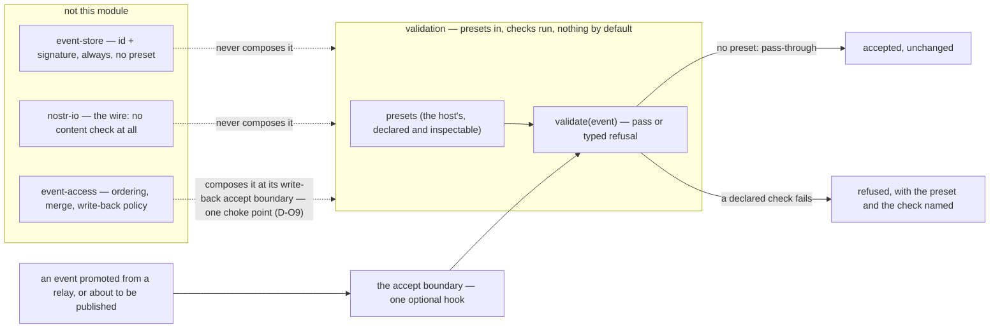

# validation — presets in, checks run, and nothing by default

**The job, in one sentence** — validate an event's **content** against presets a host supplies, at an accept
boundary, and with no presets supplied do **nothing at all**.

**This is a spec and only a spec.** No implementation exists in this run and none is planned here: the module is
this run's **fourth item** and its deliverable is this document (`runs/2026-09-29-reframing/order.md` §1, §3).
`ts/` and `evidence/` are named because they are where an implementation and its evidence would land, not because
anything is there. **Read this paragraph as of the spec's first writing only: the I4 amendment beneath `#cb7159`
records that both directories now exist**, and it — not this paragraph — is where that change is recorded.

**What it is not, in one line each.** It is **not** the store's integrity check: the event id and its schnorr
signature are checked by the store on every write, always, with no preset and no opt-out — and a correctly signed
event with nonsense content is stored, because that is the store's rule and not this module's business. It is
**not** part of the seam: the maintainer's call was that validation inside `nostr-io` is overkill there. It is
**not** a second filter predicate, and it does not touch the fail-closed identity rule that belongs to the store
and is applied at `event-access`'s boundary.

## The statements

One statement per behaviour, each a line of its own with its content-hash identity assigned by
`python3 core/checks/check.py --root . --assign` — never typed.

- `#07b8c7` — `validation` validates the **content** of an event against presets a host supplies, at an accept boundary, and **does nothing by default**: with no presets supplied it is a pass-through that refuses nothing.
- `#4b9503` — It is a module the maintainer added separately on 2026-09-29, beside the store, the seam and the composition rather than inside any of them, because validation inside the seam would be overkill there and validation inside the store would make the store know about content.
- `#cb7159` — This directory is a spec with many implementations (`#465561`), and in this run it is a **spec only**: no ts/ exists, no implementation is planned, and the document is the deliverable.

**Amended 2026-09-30 — increment I4 built it.** Read the statement above through this amendment, which does not
edit it: `ts/` and `evidence/` now exist, the implementation in `ts/` carries the contract's three exports and
eight types, and it is exercised by a green suite (twenty-three cases at I4, thirty-one after the I4b repair
recorded beneath the refusal statement), a strict typecheck and a falsification
table whose every row was made red before it was restored — so "no ts/ exists" now describes this document's
history rather than its directory. The decision that built it is
`runs/2026-09-30-first-usable-version/order-increment-4-validation.md`, and `#0bc40c`'s "a later decision
rather than a later increment of this run" is read through this same amendment: the decision was taken, and
this is it landing. What the statement's `#465561` anticipates — the Rust, Angular and Flutter implementations
the maintainer named — is still absent, so "a spec with many implementations" is unchanged; the first one
simply exists now, and this amendment is the only place the change is recorded.

- `#716ee2` — It is **not** the store's integrity check: the event id and its schnorr signature are verified by the store on every write, always and with no preset, and an event that is correctly signed with nonsense content is stored because that is the store's rule and not this module's.
- `#4b58be` — It is **not** part of the IO seam and **not** the composition's ordering: no sentence here needs a socket, a relay, a deadline or a merge, and a sentence that did would be an architecture contradiction.

**Amended 2026-09-30 — the maintainer's decision D-O25, the bounded half.** The statement above says no sentence
here needs a _deadline_; read it with this amendment, which adds bounds **without** giving this module a socket,
and the distinction is the whole point: a bound is on how long **this module waits for a resolver the host
injected**, never on the network it does not touch. The module still opens nothing.

Six bounds, part of the contract rather than tuning, each overridable per preset and each asserted by a case:

1. **references resolved per event** — the fan-out ceiling;
2. **chain depth** — whether a referenced event's own links are followed;
3. **wall-clock budget per reference** — one resolution;
4. **wall-clock budget per event** — everything one event may cost;
5. **memory held for unresolved references**, with oldest-first eviction **recorded as data loss** and never as
   a silent drop — an evicted reference is re-resolved, not forgotten;
6. **revisit count and interval** — how often a quarantined event is retried.

A bound that is exceeded is an **outcome**, not an exception: the link resolves as unresolved, which is the
quarantine outcome below. Suggested defaults, with the reasoning, are in
`runs/2026-09-30-first-usable-version/research/11-event-to-event-link-protocol.md` §4.

- `#890bd4` — A **preset** is what the host hands in — the event shape and the checks to run against it — and the module ships **none** of its own, so the default behaviour of every host that does not declare one is exactly the behaviour of no module at all.

**Amended 2026-09-30 — the maintainer's decision D-O25.** The statement above says "the event shape and the
checks to run against it"; read it with this amendment, which fixes **exactly two rule kinds and no third**:

- **a format** — for one kind, the required shape of the event itself: required tags, tag cardinalities, value
  domains, content constraints;
- **a link** — for one kind, a reference the event must satisfy **relative to another event**: follow the
  reference (by id or by address coordinate), then compare named fields between the candidate and the referenced
  event.

Both kinds are **data a consumer passes in**, never an opaque function: a rule a test cannot read is a rule a test
cannot falsify, which is the standard the composition's write-back policy already meets
(`event-access/event-access.md`, the statement that declares `WriteBackPolicy`). **The engine interprets no
kind-specific semantics at all** — not the meaning of a tag, and not an `e`-tag's fourth element in particular,
whose meaning is kind-specific and is therefore the _preset's_ to declare, never the engine's to assume. A preset
set with no rules is pass-through, which is the statement above's own default and the reason a host that declares
nothing gets exactly today's behaviour.

The market's existing NIP-99 format declarations are the first thing this **activates** rather than re-invents:
`plebeian-market/market/src/lib/schemas/productListing.ts`, `productCollection.ts` and `productReview.ts` declare their shapes and
are parsed **nowhere** (`safeParse` count 0 at the pinned submodule), so a preset for those kinds activates
declared data instead of inventing a rule. The first application's own concrete cases are in
`runs/2026-09-30-first-usable-version/research/07-validation-in-the-market.md`.

- `#d4f95d` — The preset set is a **declared, inspectable value** in the sense the store's `EvictionPolicy` and the composition's `WriteBackPolicy` are declared values (`#75322f`, `#120968`): what it accepts is read by a test rather than inferred from prose.
- `#895296` — The accept boundary is composed as **one optional hook** — an event promoted from a relay, and an event about to be published — and it is injected like every other dependency rather than reached for.

**Amended 2026-09-30 — the maintainer's decision D-O24, recorded at his instruction** (the decision text is in
`runs/2026-09-30-first-usable-version/decisions-i2-open-items.md`; the shape it cites is printed in
`event-access/event-access.md`, in the amendment beneath the statement that declares the accept hook). Read the
statement above with this amendment, which settles the _placement_ it left to the maintainer:

**This module is one implementation of the composition's single gate — it does not get a boundary of its own.**
The hook this spec names is the composition's `AcceptHook` with its `AcceptContext` (the endpoint's declared tier,
and the `resolve` a link needs), and it is applied at **three destinations** and nowhere else: the **store write**,
the **consumer delivery**, and the **wire publish** — so the number of application points falls out of the
structure rather than being remembered as a count. The module's own `validate` operation remains its own entry
for a host that calls it directly; what it must **not** do is install a second place where an event can be
accepted or refused, and its `ValidationPort` describes what it needs **of a host**, never a rival boundary.
D-O9's "one choke point and not two" is read as **one decision**, applied where content leaves — which is what
makes the publish half and the read half the same rule rather than two that must be kept in step by hand.

- `#029611` — A **refusal is typed and names its cause**: the preset and the check that fired, in a value a caller reads, never a bare string and never a silent drop.

**Amended 2026-09-30 — the maintainer's decision D-O25, the outcome vocabulary.** The statement above fixes the
refusal; read it with this amendment, which fixes what the outcomes **are**, and makes the third one explicit
because two outcomes cannot express the truth about a reference nobody could answer:

- **accepted** — every rule passed, or no rule applied with a preset that covers the candidate;
- **refused** — a rule failed and the cause is named: the preset and the check. **Four causes are refusals**, and
  they stay distinguishable in the value: the referenced event is **held and its compared fields differ**; it was
  **deleted**; it has **expired**; or the reference itself is **malformed**. A reference that was answered and
  disagreed is not the same fact as a reference nobody could answer — and neither is the same as a reference that
  does not exist;
- **quarantined** — the reference could not be resolved within the bounds stated above, so the event is **held and
  not admitted**, to be re-evaluated at the revisit interval. Quarantine is **session-scoped**: it survives no
  restart, needs no new durable storage, and is re-decided from scratch when the process returns — which is also
  why it is not the soft-guard pattern `#bc3095` refuses. **A quarantined event is never admitted.** Every outcome
  is a value a caller reads, never a bare string and never a silent drop.

**Amended 2026-09-30 — the I4b repair, on the red-team adjudication.** The statements above stand and are not
edited; read them with this amendment, which records what the first implementation's hardening pass changed, so
the document describes the directory as it now is. A **format** refusal carries the `requirement` that fired —
which required tag was missing, which cardinality was broken, which value was outside its domain, which content
bound was exceeded — so the three format refusals stay **distinguishable in the value** even when one rule
carries every requirement at once. This is a **different axis from the four causes**, which stay four; it adds
no fifth cause, and a format refusal's cause is still `'differs'`. A reference **nobody could answer** now
includes the host's resolver **rejecting** or throwing: that is quarantine, as an `undefined` answer is, and
never an exception escaping the module. A preset the engine cannot interpret — a comparator outside the closed
vocabulary, or a bound asking for a **chain** this engine does not take — is refused **at the preset, before any
candidate is judged**, so it fails the same way whatever the candidate's state; the chain itself is still not
followed, because what a _referenced_ event's own links are is not this spec's to invent. Bound 1 counts
**resolutions attempted** — one per link, from the occurrence the preset names — and bound 5's **eviction
record is bounded** too, a count with the last few names rather than a log that grows with every eviction. A
**specific preset wins over a wildcard**, whatever order the host declared them in. The adjudication, with the
two blind reports it decides between, is
`runs/2026-09-30-first-usable-version/adjudication-i4-red-team.md`; the suite is thirty-one cases and the
falsification table thirty-one mutations, one per case, every row red before it was restored.

**Amended 2026-09-30 — the I4c repair (the A6 finding).** The statements above stand and are not edited; read
them with this amendment, which records one line of the link half's clock. **The default clock is a real
clock**, not a frozen constant: bound 6's revisit gate is `now - lastAttemptAt >= intervalMs`, so a clock frozen
at a constant makes that gate false forever, and a reference quarantined in that configuration can never be
revisited — a declared bound with no mechanism in a supported configuration, which is a claim this module cannot
honour. With **no injected port and no injected clock**, then, a reference nobody can answer is quarantined and
**is retried once the interval has passed** — the gate has a mechanism in every configuration the module
supports. An injected `clock` still wins, and a port's own `now()` is still preferred when a port is given; the
last resort is the host's wall clock, the same shape the store's own `SYSTEM_CLOCK` takes
(`event-store/ts/store.ts`) and, like it, this module's **one** host read — every other edge is still injected
and `#8e6079` otherwise holds exactly as written, no socket and no other global. The finding and its decision
are the addendum of `runs/2026-09-30-first-usable-version/adjudication-i4-red-team.md`; the suite is now
thirty-two cases and the falsification table thirty-two mutations, one per case.

- `#0df9fb` — Nothing is **repaired** here: a malformed event is refused or passed, never corrected, which is the same fail-closed discipline the store's identity guard applies to its own inputs (`#75322f`, and commit `fb304df` there) and not a second implementation of it.
- `#18faf1` — The module knows **no event kind of its own**: a preset that names a kind is stating the host's claim, and this module never carries a kind table, a schema library or a domain vocabulary.

**Amended 2026-09-30 — the maintainer's decision D-O25, the link half.** The statement above is exactly why a
**link** is a declared rule and not engine code: this module carries no kind table, so it cannot know that a given
kind's `e` tag names an auction root, or that an `a` tag names a coordinate. A link therefore _names_ what to
follow and what to compare — the reference, the fetch strategy (by id, by coordinate, or by id with a coordinate
fallback), and the named fields to compare together with the comparison each requires — while the **kind's
meaning stays the preset's claim**. A chain of links is bounded by the depth bound stated above, and a link's
outcomes are the vocabulary stated beneath the refusal statement. The protocol rules this respects, each with its
citation, are in `runs/2026-09-30-first-usable-version/research/11-event-to-event-link-protocol.md` §1–§2.

- `#8e6079` — It reads **no host global, no framework and no app import** (`#465561`'s rule that a module may not import the app), and the presets, the clock and the hook are all injected ports.

**Amended 2026-10-01 — the citation above is corrected, not the statement.** The rule the statement cites is
not `#465561` (`platform-core/platform-core.md:315`, which states that a directory is a spec and a spec has many
implementations); the rule that a core module may not import the app is unhashed prose at
`platform-core/platform-core.md:37`. The statement's claim — no host global, no framework and no app import — is
itself true of the tree; only the pointer is wrong, and the statement is read through this note.

- `#40d21a` — The **stop conditions** are stated so a reviewer can falsify them: a sentence here that needs a socket, a store, a second integrity check, a second head rule or a second filter predicate is an **architecture contradiction**, and so is a preset language that only one implementation could satisfy.
- `#0bc40c` — The **target → increment map** is named rather than implied: this run delivers the spec alone, and the implementation is a later decision rather than a later increment of this run.
- `#ab04eb` — The evidence obligations are stated as criteria: a pass-through case with no presets, a refusal case with a declared preset that fails, and an accept case with a declared preset that passes — each one failing if the module's default ever stops being a pass-through.

**Amended 2026-09-30 — the maintainer's decisions D-O24 and D-O25 extend the obligations.** The three cases above
stand and remain the floor. The revision adds, one case each and each naming the careless implementation it fails
on: a **format** rule that refuses a malformed candidate and accepts a conforming one; a **link** rule for each of
the three outcomes — matched, mismatched, unresolved — with the refusal causes distinguishable in the value; the
**pass-through default** re-asserted over a candidate no preset covers; a **bound** exceeded becoming an outcome
rather than an exception; and **one falsification mutation per case**, so no case is green because it never ran.
The composition side of the boundary — that a query's answer is really _filtered_ and that `publish` writes
nothing a gate dropped — is `event-access`'s obligation and is stated there, in
`runs/2026-09-30-first-usable-version/order-increment-2b-gate.md`.

- `#d6a8de` — The declared exceptions are named when they are taken: a preset's own shape is a named exception of whichever implementation adopts a library for it, and this spec keeps the spec's nouns — preset, check, outcome, refusal — as the protocol's.

## Where it sits, and where it is not

## The target → increment map

| spec surface                                                                                                                   | increment                                                                                     | what exists instead, today                             |
| ------------------------------------------------------------------------------------------------------------------------------ | --------------------------------------------------------------------------------------------- | ------------------------------------------------------ |
| this document                                                                                                                  | **I4 — this run's fourth item, spec only**                                                    | nothing else: no ts/, no evidence/, no import anywhere |
| ts/ — presets, the hook, the typed refusal                                                                                     | **a later decision**, not an increment of this run                                            | nothing                                                |
| where the hook composes: the composition's write-back accept boundary, with the publish path passing through the same boundary | **decided 2026-09-30 (D-O9)** — the composition's write-back accept boundary, one choke point | nothing: the boundary is a decision, not a build       |
| the store's own integrity check                                                                                                | **not this module** — the store's, always                                                     | built, and unchanged by this document                  |
| the fail-closed identity rule                                                                                                  | **not this module** — the store's predicate, applied at `event-access`'s boundary             | repaired in `fb304df` and owned there                  |

## Findings reported rather than repaired

1. **Where the module composes is still a decision, and this spec does not take it.** The maintainer's note
   lists it as open (`runs/2026-09-29-event-store/notes/2026-09-29-io-seam-unifier-and-validation.md` §5, §7.5):
   the hook could sit on the composition's write-back, on the seam's publish path, or on both. This document
   states the **shape** of the hook and leaves the placement open, because its owner is the maintainer and a
   spec author taking it would be improvising.

   **Decided 2026-09-30 — the orchestrator's decision D-O9**
   (`runs/2026-09-30-first-usable-version/decisions-orchestrator.md`): the hook composes at the **composition's
   write-back accept boundary** (`event-access/event-access.md`), and the **publish path passes through that same
   boundary**, so there is exactly **one choke point** where unvalidated content can enter the store — two
   composition points would be two implementations of one accept decision, and one boundary is testable with one
   fake port. **No presets means pass-through** continues to hold at that boundary.

2. **A preset language is not chosen here.** JSON Schema, a structural predicate and a typed schema library are
   all satisfiable, and the module's rule is that the _spec's_ nouns are its own; whichever an implementation
   adopts is that implementation's named exception. Choosing one now would decide for four future hosts.

   **Decided 2026-09-30 — the orchestrator's decision D-O9**
   (`runs/2026-09-30-first-usable-version/decisions-orchestrator.md`): a preset is **data** — a record naming the
   kinds it applies to and the requirement it imposes, **selecting among host-supplied typed predicates** — and
   **no presets means pass-through**, so the module never invents a check. The spec's nouns stay the spec's, and
   whichever library an implementation adopts for a predicate remains that implementation's named exception.

3. **The module is not on any critical path, and that is recorded so nobody schedules it.** Nothing in this run
   imports it, nothing in this run's increments needs it, and the store ships without it — which is also why the
   spec is the whole deliverable.
4. **`UNVERIFIED`:** no measurement was made for this document, because there is nothing to measure. Every claim
   above is either a statement of the intended contract or a `path:line` reference to the note and the order that
   decided it.

## Open, and left open on purpose

`#2eb7fd` — **The preset language**, and whether a preset is data (JSON Schema-shaped) or a typed predicate the host supplies as a function: the module's rule is the same either way, and the choice is the increment's when it is ordered.

`#939633` — **Which accept boundary composes it first**, and whether a refusal is a rejection the caller must handle or a report the caller may ignore — a pass-through default and a typed refusal together suggest the former, and the first real composer settles it.

`#bc3095` — **Whether a refusal should ever be recoverable** (a preset that warns rather than refuses), which is the soft-guard pattern the wallet rule used and which this spec does not adopt because a validation module that warns is a validation module that does not validate.

**Amended 2026-09-30 — the maintainer's decision D-O25 answers this without reopening it.** A warning is still
refused as a shape: nothing here admits an event it did not accept. What D-O25 adds is a **third outcome beside
accept and refuse — quarantine** — and it is not a soft guard: a quarantined event is **not admitted**, it is held
and re-evaluated within stated bounds, and it enters only if a later resolution turns unresolved into matched.
The sentence above stands exactly as written, and the difference between "warn and let it through" and "hold it
and ask again under a bound" is the whole of the amendment.

**Amended 2026-09-30 — the orchestrator's decisions D-O9**
(`runs/2026-09-30-first-usable-version/decisions-orchestrator.md`). `#2eb7fd` is settled in shape: a preset is
**data** — a record naming the kinds it applies to and the requirement it imposes, selecting among
host-supplied typed predicates — the spec's nouns stay the spec's. `#939633` is settled: the accept boundary
that composes it first is the composition's **write-back accept boundary**, and the publish path passes through
that same boundary, so there is **one choke point** and not two. **No presets means pass-through.** `#bc3095`
stands exactly as written — a refusal is a refusal.

## Fan-out 2026-10-03 — the content-addressing convention (R1–R4)

**Amended 2026-10-03 — the four hardened rules of `runs/2026-10-02-content-addressing/FANOUT.md`, applied.**
The statements above stand and are not edited; the declaring lines are neither rewritten nor deleted. What this
amendment records is the fan-out itself: the implementation in `ts/` now cites, in the doc comment directly
above each declaration, the **narrowest** statement that requires it (R4), so the spec ↔ implementation link is
searchable from the code side and no declaration is left as a question.

**R1 — an amendment that changes the requirement mints a new identity.** Four requirements changed under an
amendment in this body, so each moves to a **new** statement below with its own identity, and the
implementation cites the **new** one; the old identity survives as history, cited only here or as the
unchanged half it still states:

- `#890bd4` — its D-O25 amendment fixes **exactly two rule kinds and no third** (data, never a function); the
  new statement is `#485b96`, and the code's rule-kind citations point at it.
- `#895296` — its D-O24 amendment settles the **placement** and adds the third destination ("one implementation
  of the composition's single gate, no boundary of its own"); the new statement is `#8393ac`.
- `#4b58be` — its D-O25 amendment adds the **six bounds** the statement's own sentence forbade a deadline for;
  the new statement is `#e80b77`, and the bounds code cites it (the negative statement itself is cited as
  **provenance**, R2).
- `#029611` — its D-O25 amendment fixes the **three-outcome vocabulary**; the new statement is `#6bf840`, and
  `ValidationOutcome` cites it. `#029611` itself survives unchanged as the fulfilment of the refusal half.

**R2 — provenance is marked, fulfilment is not.** Three statements above are negative or meta and are cited
from the code with the `(provenance)` marker, never scored as fulfilled: `#4b58be` ("not part of the seam"),
`#18faf1` ("knows no event kind of its own") and `#40d21a` (the reviewer's stop conditions). The two in the test
file (`#ab04eb`, `#bc3095`) are marked the same way.

**R3 — test support is exempt by declaration.** The front-matter's `test-support: ["ts/harness.ts",
"ts/*.test.ts"]` is the on-the-record decision that the host side of the ports needs no statement of its own.

**The module-local verifier.** The fan-out's evidence is `evidence/hash-refs.py` — it reads this module's two
specs plus its ancestors, resolves every token the code carries, lists uncovered declarations and files, and
prints; the capture is `evidence/03-hash-refs.txt`.

**R4 — cite the narrowest statement; mark the one-implementation rule.** The statements below are minted so a
declaration cites the requirement that actually requires it rather than a module summary; each statement that
means "exactly one implementation" carries the literal marker `[1:1]`, so the count is testable.

- `#a3accd` — The event view is a raw `nostr-tools` event adopted rather than wrapped (E2), so a comparison over `id` compares real bytes.
- `#06cc5e` — The refusal causes are a closed four-member vocabulary — `differs`, `deleted`, `expired`, `malformed-reference` — and they stay distinguishable in the value. `[1:1]`
- `#e4b72f` — A format refusal additionally carries the requirement that fired — `missing-tag`, `cardinality`, `domain`, `content`, a closed vocabulary on a different axis from the four causes. `[1:1]`
- `#485b96` — A rule is data and its kind is a closed two-member union — a `format` and a `link`, and no third; the engine interprets no kind's semantics, and a rule a test cannot read is a rule a test cannot falsify. `[1:1]`
- `#f7aab6` — A preset names the kinds it covers and the checks to run against them, with its own bound overrides, and an empty `kinds` list is the wildcard. `[1:1]`
- `#0fea4f` — The comparator vocabulary is closed — `eq`, `exists`, `in` — and a comparator outside it is a preset the engine cannot interpret before any candidate is judged, never a per-candidate verdict. `[1:1]`
- `#d10f8b` — A link names its reference strategy — by id, by coordinate, or by id with a coordinate fallback — and the engine reads only the reference's shape, never a kind's meaning.
- `#c7e678` — A comparison names each field by its tag and index, so the engine stays kind-blind and never reads what an element means.
- `#7efb71` — A format names required tags with their cardinalities, value domains and a content byte bound, all read from the preset's data.
- `#82c32d` — The port answers `held`, `deleted` or `expired`, or `undefined` meaning nobody could answer it, and the host — not this module — is what tells them apart.
- `#8393ac` — The two operations are `validate`, the module's own entry, and `accept`, the composition's hook; the module installs no second boundary of its own, so one implementation serves the one gate. `[1:1]`
- `#e80b77` — The six bounds are declared values with their per-preset override, and a bound that is exceeded is an outcome, never an exception.
- `#fb9a0a` — The unresolved-reference book is session-scoped and bounded on both sides — its held bytes by the ceiling, its eviction record by a count plus the last few names, oldest first and recorded as data loss. `[1:1]`
- `#bd3b66` — The reference byte length is counted over the language's own code points, so the memory bound needs no host global to measure it.
- `#77d411` — The link half reads the occurrence its preset names — one reference per link check — and maps an unanswered, a rejected and a timed-out reference alike to quarantine.
- `#6bf840` — The three outcomes are `accepted`, `refused` and `quarantined`, and a quarantined event is never admitted.
